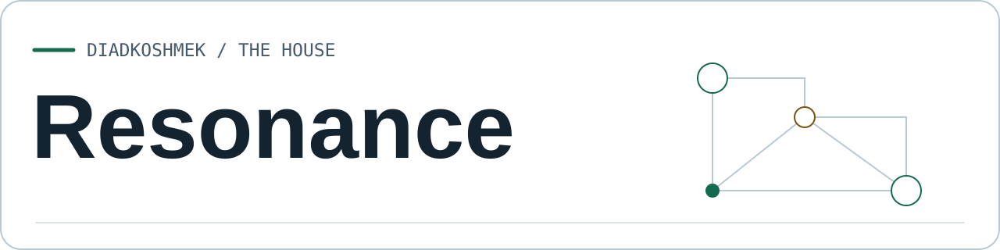
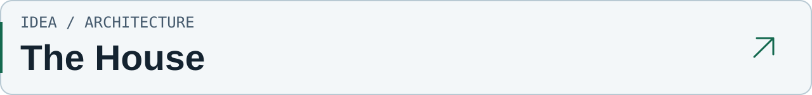
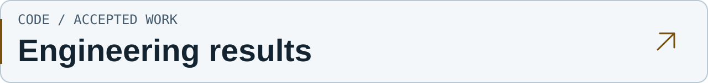
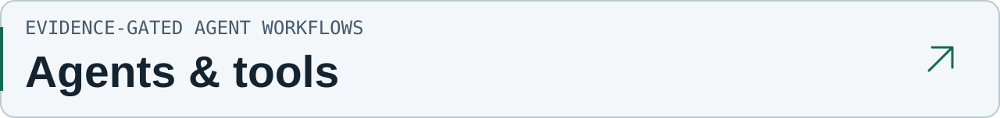
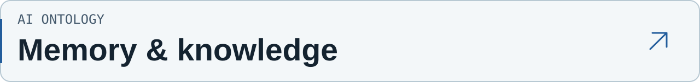
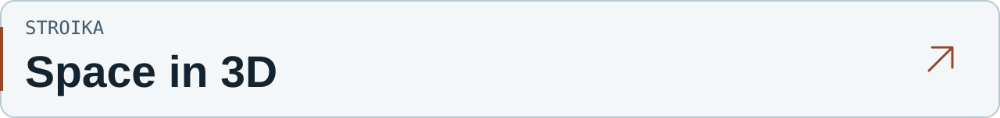

<picture>
  <source media="(prefers-color-scheme: dark) and (max-width: 600px)" srcset="https://raw.githubusercontent.com/DiadkoShmek/DiadkoShmek/main/assets/identity/resonance-dark-mobile.svg">
  <source media="(max-width: 600px)" srcset="https://raw.githubusercontent.com/DiadkoShmek/DiadkoShmek/main/assets/identity/resonance-light-mobile.svg">
  <source media="(prefers-color-scheme: dark)" srcset="https://raw.githubusercontent.com/DiadkoShmek/DiadkoShmek/main/assets/identity/resonance-dark.svg">
  
</picture>

**Independent AI systems. Memory, tools and engineering with verification.**

[The House](https://github.com/DiadkoShmek/DiadkoShmek/blob/main/house/book/en/README.md) · [Engineering results](https://github.com/DiadkoShmek/engineering-results) · [Українська](https://github.com/DiadkoShmek/DiadkoShmek/blob/main/README.md)

<a href="https://github.com/DiadkoShmek/DiadkoShmek/blob/main/house/book/en/README.md">
<picture>
  <source media="(prefers-color-scheme: dark) and (max-width: 600px)" srcset="https://raw.githubusercontent.com/DiadkoShmek/DiadkoShmek/main/assets/identity/entry-house-en-dark-mobile.svg">
  <source media="(max-width: 600px)" srcset="https://raw.githubusercontent.com/DiadkoShmek/DiadkoShmek/main/assets/identity/entry-house-en-light-mobile.svg">
  <source media="(prefers-color-scheme: dark)" srcset="https://raw.githubusercontent.com/DiadkoShmek/DiadkoShmek/main/assets/identity/entry-house-en-dark.svg">
  
</picture>
</a>

AI, memory and original tools as one system. A book with explanations and diagrams. **[Read the book](https://github.com/DiadkoShmek/DiadkoShmek/blob/main/house/book/en/README.md)** · [PDF](https://github.com/DiadkoShmek/DiadkoShmek/blob/main/house/pdf/the-house-en.pdf)

<a href="https://github.com/DiadkoShmek/engineering-results">
<picture>
  <source media="(prefers-color-scheme: dark) and (max-width: 600px)" srcset="https://raw.githubusercontent.com/DiadkoShmek/DiadkoShmek/main/assets/identity/entry-results-en-dark-mobile.svg">
  <source media="(max-width: 600px)" srcset="https://raw.githubusercontent.com/DiadkoShmek/DiadkoShmek/main/assets/identity/entry-results-en-light-mobile.svg">
  <source media="(prefers-color-scheme: dark)" srcset="https://raw.githubusercontent.com/DiadkoShmek/DiadkoShmek/main/assets/identity/entry-results-en-dark.svg">
  
</picture>
</a>

Open-source fixes, audits and competitions. Each case links to its evidence. **[Explore the cases](https://github.com/DiadkoShmek/engineering-results)**

[Journal](https://github.com/DiadkoShmek/DiadkoShmek/blob/main/RESULTS.en.md) · [Engineering method](https://github.com/DiadkoShmek/DiadkoShmek/blob/main/ENGINEERING.md)

## Original projects

<a href="https://github.com/DiadkoShmek/evidence-gated-agent-workflows">
<picture>
  <source media="(prefers-color-scheme: dark) and (max-width: 600px)" srcset="https://raw.githubusercontent.com/DiadkoShmek/DiadkoShmek/main/assets/identity/entry-workflows-en-dark-mobile.svg">
  <source media="(max-width: 600px)" srcset="https://raw.githubusercontent.com/DiadkoShmek/DiadkoShmek/main/assets/identity/entry-workflows-en-light-mobile.svg">
  <source media="(prefers-color-scheme: dark)" srcset="https://raw.githubusercontent.com/DiadkoShmek/DiadkoShmek/main/assets/identity/entry-workflows-en-dark.svg">
  
</picture>
</a>

Runnable examples of evidence checks, task state and artifact handoff between agents. **[Open the code](https://github.com/DiadkoShmek/evidence-gated-agent-workflows)**

<a href="https://github.com/DiadkoShmek/ai-ontology">
<picture>
  <source media="(prefers-color-scheme: dark) and (max-width: 600px)" srcset="https://raw.githubusercontent.com/DiadkoShmek/DiadkoShmek/main/assets/identity/entry-ontology-en-dark-mobile.svg">
  <source media="(max-width: 600px)" srcset="https://raw.githubusercontent.com/DiadkoShmek/DiadkoShmek/main/assets/identity/entry-ontology-en-light-mobile.svg">
  <source media="(prefers-color-scheme: dark)" srcset="https://raw.githubusercontent.com/DiadkoShmek/DiadkoShmek/main/assets/identity/entry-ontology-en-dark.svg">
  
</picture>
</a>

A research book and references for continuity, evidence and revision. **[Explore the project](https://github.com/DiadkoShmek/ai-ontology)**

<a href="https://diadkoshmek.github.io/mae7-viewer/">
<picture>
  <source media="(prefers-color-scheme: dark) and (max-width: 600px)" srcset="https://raw.githubusercontent.com/DiadkoShmek/DiadkoShmek/main/assets/identity/entry-stroika-en-dark-mobile.svg">
  <source media="(max-width: 600px)" srcset="https://raw.githubusercontent.com/DiadkoShmek/DiadkoShmek/main/assets/identity/entry-stroika-en-light-mobile.svg">
  <source media="(prefers-color-scheme: dark)" srcset="https://raw.githubusercontent.com/DiadkoShmek/DiadkoShmek/main/assets/identity/entry-stroika-en-dark.svg">
  
</picture>
</a>

An architectural house viewer with links to project references. **[Open the viewer](https://diadkoshmek.github.io/mae7-viewer/)**

[STROIKA code](https://github.com/DiadkoShmek/mae7-viewer)

[All original repositories](https://github.com/DiadkoShmek?tab=repositories&type=source)

Contributions to external projects

[All PRs and their statuses](https://github.com/DiadkoShmek/engineering-results/blob/main/PR_STATUS.en.md) · [Source-linked case reports](https://github.com/DiadkoShmek/engineering-results/blob/main/reports/README.md)

Work and verification

I direct the work and own follow-up. Development and verification use AI tools. The prototypes document their test conditions and limits.

[Agent Workflows](https://github.com/DiadkoShmek/evidence-gated-agent-workflows/blob/main/run_proof.py): `python3 run_proof.py`. [Profile checks](https://github.com/DiadkoShmek/DiadkoShmek/blob/main/.github/workflows/profile-proof.yml). Questions — through project Issues.

