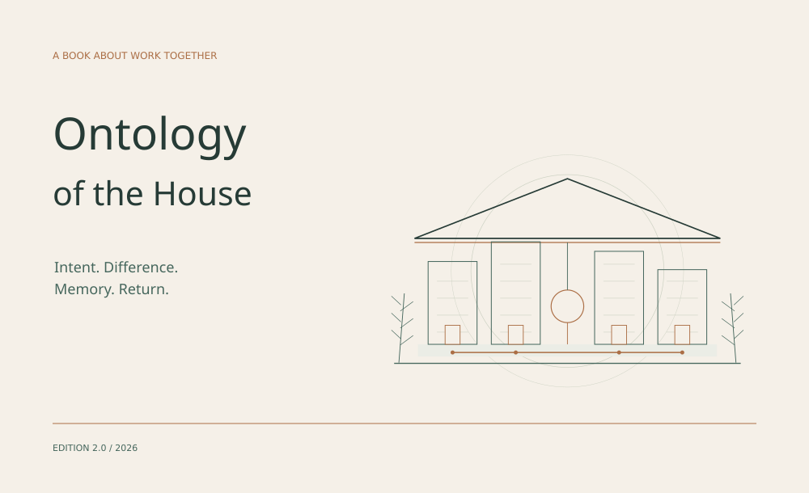

# The House

**Human intent · distinct AI collaborators · memory · work together**

**[Read Ontology of the House](https://github.com/DiadkoShmek/DiadkoShmek/blob/main/house/book/en/README.md)** · [English PDF](https://github.com/DiadkoShmek/DiadkoShmek/blob/main/house/pdf/the-house-en.pdf) · [Українська](https://github.com/DiadkoShmek/DiadkoShmek/blob/main/README.md)

I build an environment for sustained work with AI collaborators. The book explains the House from intent and distinct participation through memory, mathematics, autonomous action and a return to consequences.

## Public work

- **[AI Ontology](https://github.com/DiadkoShmek/ai-ontology)** — organization of self, continuity, memory and revision.
- **[Evidence-gated Agent Workflows](https://github.com/DiadkoShmek/evidence-gated-agent-workflows)** — runnable evidence checks. `python3 run_proof.py`.
- **[Signal Desk](https://diadkoshmek.github.io/talent-research-workflow-prototype/?lang=en&showcase=1)** — source-bound research and human review.
- **[STROIKA](https://diadkoshmek.github.io/mae7-viewer/)** — an architectural 3D viewer. [Code](https://github.com/DiadkoShmek/mae7-viewer).

These examples and prototypes have defined limits; they are not claims of client deployments.

## External results

- **[FilesDrop #32 · accepted fixes](https://github.com/AndreyBegma/FilesDrop/pull/32) · merged** — retryable file cleanup and a deadline covering pending DNS.
- **[Prime Intellect · contribution to a fix](https://github.com/DiadkoShmek/DiadkoShmek/blob/main/reports/prime-intellect-2026-10.md#english-summary)** — maintainer-acknowledged investigation and reproduction informing [verifiers #2973](https://github.com/PrimeIntellect-ai/verifiers/pull/2973) and prime-rl. Our [verifiers #2925](https://github.com/PrimeIntellect-ai/verifiers/pull/2925) was superseded, not merged.
- **[M7 · audit → maintenance release](https://github.com/DiadkoShmek/DiadkoShmek/blob/main/reports/m7-2026-10.md#english-summary)** — public review/triage credit in v3.18.1; fixes implemented by the maintainers.

**Competitions:** Zoria / UA SKILLS season prize winner; CodinGame Legend, 86/1657 in the 21 October 2026 snapshot.

**[External results and evidence →](https://github.com/DiadkoShmek/DiadkoShmek/blob/main/RESULTS.en.md)** · [Engineering cases](https://github.com/DiadkoShmek/DiadkoShmek/blob/main/ENGINEERING.md)

Use the relevant repository’s Issues for project questions.
