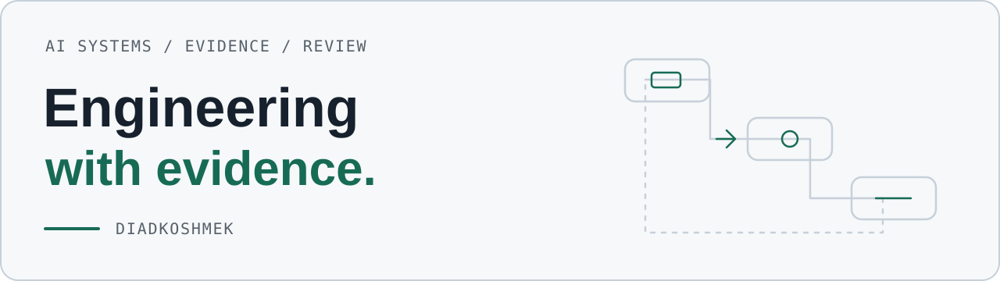

# DiadkoShmek

<picture>
  <source media="(prefers-color-scheme: dark) and (max-width: 600px)" srcset="https://raw.githubusercontent.com/DiadkoShmek/DiadkoShmek/main/assets/identity/profile-dark-mobile.svg">
  <source media="(max-width: 600px)" srcset="https://raw.githubusercontent.com/DiadkoShmek/DiadkoShmek/main/assets/identity/profile-light-mobile.svg">
  <source media="(prefers-color-scheme: dark)" srcset="https://raw.githubusercontent.com/DiadkoShmek/DiadkoShmek/main/assets/identity/profile-dark.svg">
  
</picture>

**AI systems · runtime reliability · verifiable results**

[Українська](https://github.com/DiadkoShmek/DiadkoShmek/blob/main/README.md) · [Results](https://github.com/DiadkoShmek/DiadkoShmek/blob/main/RESULTS.en.md) · [Engineering cases](https://github.com/DiadkoShmek/DiadkoShmek/blob/main/ENGINEERING.md)

## Projects

- **[Evidence-gated Agent Workflows](https://github.com/DiadkoShmek/evidence-gated-agent-workflows)** — evidence checks, task lifecycle and artifact handoff.
- **[AI Ontology](https://github.com/DiadkoShmek/ai-ontology)** — a research book, proposed audit profile and executable continuity/revision references.
- **[Signal Desk](https://diadkoshmek.github.io/talent-research-workflow-prototype/?lang=en&showcase=1)** — public sources, human review and context handoff. [Code](https://github.com/DiadkoShmek/talent-research-workflow-prototype).
- **[STROIKA](https://diadkoshmek.github.io/mae7-viewer/)** — architectural 3D review with project references. [Code](https://github.com/DiadkoShmek/mae7-viewer).

## External results

**[Results book →](https://github.com/DiadkoShmek/engineering-results)**

**9 directly merged PRs · 3 contributions incorporated into merged maintainer fixes.** [104 external PRs: 88 open, 7 closed without merge](https://github.com/DiadkoShmek/engineering-results/blob/main/PR_STATUS.en.md). Snapshot: 4 November 2026, 16:20 UTC.

- **[Lezo: 20 new submissions](https://github.com/DiadkoShmek/engineering-results/blob/main/reports/lezo-2026-11.md#english-summary)** — dated local checks and review states.
- **Resource reliability:** [Microsoft Semantic Kernel #14701](https://github.com/microsoft/semantic-kernel/pull/14701) · [Redis #4550](https://github.com/redis/redis-py/pull/4550) — merged.
- **Merged code:** [ONNX #8734](https://github.com/onnx/onnx/pull/8734) · [ONNX IR #521](https://github.com/onnx/ir-py/pull/521) · [TensorLy #695](https://github.com/tensorly/tensorly/pull/695) · [BlackJAX #1068](https://github.com/blackjax-devs/blackjax/pull/1068).
- **SDKs and integrations:** [Braintrust #2701](https://github.com/braintrustdata/braintrust-sdk-javascript/pull/2701) · [Kraft #1227](https://github.com/itsOmidKarami/kraft/pull/1227) · [FilesDrop #32](https://github.com/AndreyBegma/FilesDrop/pull/32) · merged.
- **[Prime Intellect](https://github.com/DiadkoShmek/engineering-results/blob/main/reports/prime-intellect-2026-10.md#english-summary):** investigation informing [verifiers #2973](https://github.com/PrimeIntellect-ai/verifiers/pull/2973) and prime-rl; our [#2925](https://github.com/PrimeIntellect-ai/verifiers/pull/2925) was superseded, not merged.
- **[TensorDict](https://github.com/DiadkoShmek/engineering-results/blob/main/reports/tensordict-2026-11.md#english-summary)** and **[TVM-FFI](https://github.com/DiadkoShmek/engineering-results/blob/main/reports/tvm-ffi-2026-11.md#english-summary):** credited contributions to merged maintainer implementations.
- **[M7 MCP](https://github.com/DiadkoShmek/engineering-results/blob/main/reports/m7-2026-10.md#english-summary):** technical audit with release credit.
- **Competitions:** Zoria / UA SKILLS season prize winner; CodinGame Legend, 86/1657 in the 21 October 2026 snapshot.

**[Dates and primary sources →](https://github.com/DiadkoShmek/DiadkoShmek/blob/main/RESULTS.en.md)**

## Documentation

[Ontology of the House · English](https://github.com/DiadkoShmek/DiadkoShmek/blob/main/house/book/en/README.md) · [Українською](https://github.com/DiadkoShmek/DiadkoShmek/blob/main/house/book/uk/README.md) · [PDF](https://github.com/DiadkoShmek/DiadkoShmek/blob/main/house/pdf/the-house-en.pdf)

## Status and verification

I direct the work and take responsibility for contribution follow-up; development and validation use AI assistance. Each prototype has a defined contract and scope; these are not claims of client deployments. Run the workflow references with `python3 run_proof.py`.

Use the relevant repository’s Issues for technical questions.
