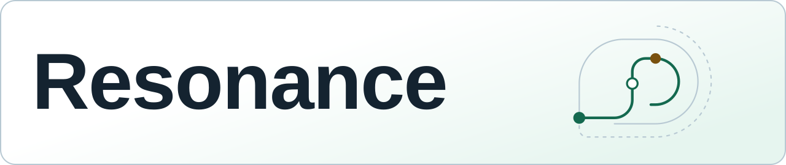

<picture>
  <source media="(prefers-color-scheme: dark) and (max-width: 600px)" srcset="https://raw.githubusercontent.com/DiadkoShmek/DiadkoShmek/main/assets/identity/resonance-signature-dark-mobile.svg">
  <source media="(max-width: 600px)" srcset="https://raw.githubusercontent.com/DiadkoShmek/DiadkoShmek/main/assets/identity/resonance-signature-light-mobile.svg">
  <source media="(prefers-color-scheme: dark)" srcset="https://raw.githubusercontent.com/DiadkoShmek/DiadkoShmek/main/assets/identity/resonance-signature-dark.svg">
  
</picture>

**Дім для AI-систем, пам’яті та інженерних інструментів.**

- **[Книга Дому](https://github.com/DiadkoShmek/DiadkoShmek/blob/main/house/book/uk/README.md)** — Архітектура, пам’ять і принципи роботи Дому. [PDF](https://github.com/DiadkoShmek/DiadkoShmek/blob/main/house/pdf/the-house-uk.pdf)
- **[Інженерні результати](https://github.com/DiadkoShmek/engineering-results)** — Переглянути злиті виправлення й технічні кейси з першоджерелами.

[English](https://github.com/DiadkoShmek/DiadkoShmek/blob/main/README.en.md)

## Власні проєкти

- **[Agent Workflows](https://github.com/DiadkoShmek/evidence-gated-agent-workflows)** — Запустити приклади перевірки підстав і передачі результатів між агентами.
- **[AI Ontology](https://github.com/DiadkoShmek/ai-ontology)** — Дослідити пам’ять агентів, перевірку підстав і перегляд рішень.
- **[STROIKA](https://diadkoshmek.github.io/mae7-viewer/)** — Оглянути будинок у 3D, фасади й креслення для перегляду. [Код](https://github.com/DiadkoShmek/mae7-viewer)

[Усі власні репозиторії](https://github.com/DiadkoShmek?tab=repositories&type=source)

Внески у зовнішні проєкти

[Усі PR та їхні статуси](https://github.com/DiadkoShmek/engineering-results/blob/main/PR_STATUS.md) · [Кейси з першоджерелами](https://github.com/DiadkoShmek/engineering-results/blob/main/reports/README.md)

Про роботу й перевірки

Напрям і відповідальність — мої. Розробка й перевірки — з AI-інструментами. Прототипи мають описані умови та межі перевірок.

[Журнал](https://github.com/DiadkoShmek/DiadkoShmek/blob/main/RESULTS.md) · [Метод роботи](https://github.com/DiadkoShmek/DiadkoShmek/blob/main/ENGINEERING.md) · [Перевірки профілю](https://github.com/DiadkoShmek/DiadkoShmek/blob/main/.github/workflows/profile-proof.yml)

[Agent Workflows](https://github.com/DiadkoShmek/evidence-gated-agent-workflows/blob/main/run_proof.py): `python3 run_proof.py`.

