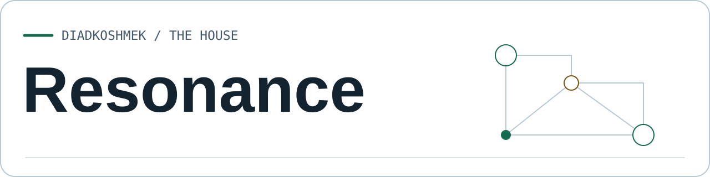
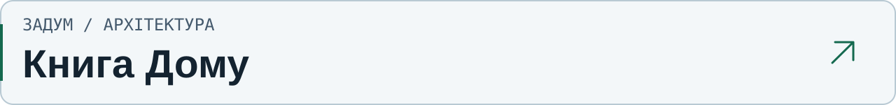
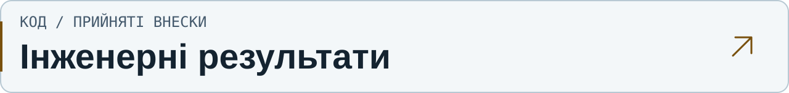
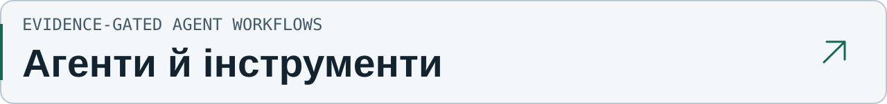
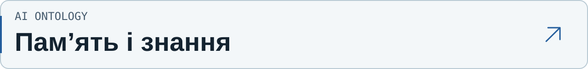
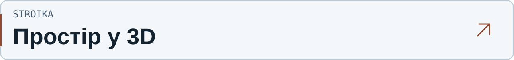

<picture>
  <source media="(prefers-color-scheme: dark) and (max-width: 600px)" srcset="https://raw.githubusercontent.com/DiadkoShmek/DiadkoShmek/main/assets/identity/resonance-dark-mobile.svg">
  <source media="(max-width: 600px)" srcset="https://raw.githubusercontent.com/DiadkoShmek/DiadkoShmek/main/assets/identity/resonance-light-mobile.svg">
  <source media="(prefers-color-scheme: dark)" srcset="https://raw.githubusercontent.com/DiadkoShmek/DiadkoShmek/main/assets/identity/resonance-dark.svg">
  
</picture>

**Власні AI-системи. Пам’ять, інструменти й інженерія з перевіркою.**

[Книга Дому](https://github.com/DiadkoShmek/DiadkoShmek/blob/main/house/book/uk/README.md) · [Інженерні результати](https://github.com/DiadkoShmek/engineering-results) · [English](https://github.com/DiadkoShmek/DiadkoShmek/blob/main/README.en.md)

<a href="https://github.com/DiadkoShmek/DiadkoShmek/blob/main/house/book/uk/README.md">
<picture>
  <source media="(prefers-color-scheme: dark) and (max-width: 600px)" srcset="https://raw.githubusercontent.com/DiadkoShmek/DiadkoShmek/main/assets/identity/entry-house-uk-dark-mobile.svg">
  <source media="(max-width: 600px)" srcset="https://raw.githubusercontent.com/DiadkoShmek/DiadkoShmek/main/assets/identity/entry-house-uk-light-mobile.svg">
  <source media="(prefers-color-scheme: dark)" srcset="https://raw.githubusercontent.com/DiadkoShmek/DiadkoShmek/main/assets/identity/entry-house-uk-dark.svg">
  
</picture>
</a>

Як поєднуються AI, пам’ять і власні інструменти. Книга з поясненнями та схемами. **[Читати](https://github.com/DiadkoShmek/DiadkoShmek/blob/main/house/book/uk/README.md)** · [PDF](https://github.com/DiadkoShmek/DiadkoShmek/blob/main/house/pdf/the-house-uk.pdf)

<a href="https://github.com/DiadkoShmek/engineering-results">
<picture>
  <source media="(prefers-color-scheme: dark) and (max-width: 600px)" srcset="https://raw.githubusercontent.com/DiadkoShmek/DiadkoShmek/main/assets/identity/entry-results-uk-dark-mobile.svg">
  <source media="(max-width: 600px)" srcset="https://raw.githubusercontent.com/DiadkoShmek/DiadkoShmek/main/assets/identity/entry-results-uk-light-mobile.svg">
  <source media="(prefers-color-scheme: dark)" srcset="https://raw.githubusercontent.com/DiadkoShmek/DiadkoShmek/main/assets/identity/entry-results-uk-dark.svg">
  
</picture>
</a>

Виправлення у відкритих бібліотеках, аудити й змагання. Кожен кейс веде до джерел. **[Дивитися кейси](https://github.com/DiadkoShmek/engineering-results)**

[Журнал](https://github.com/DiadkoShmek/DiadkoShmek/blob/main/RESULTS.md) · [Метод роботи](https://github.com/DiadkoShmek/DiadkoShmek/blob/main/ENGINEERING.md)

## Власні проєкти

<a href="https://github.com/DiadkoShmek/evidence-gated-agent-workflows">
<picture>
  <source media="(prefers-color-scheme: dark) and (max-width: 600px)" srcset="https://raw.githubusercontent.com/DiadkoShmek/DiadkoShmek/main/assets/identity/entry-workflows-uk-dark-mobile.svg">
  <source media="(max-width: 600px)" srcset="https://raw.githubusercontent.com/DiadkoShmek/DiadkoShmek/main/assets/identity/entry-workflows-uk-light-mobile.svg">
  <source media="(prefers-color-scheme: dark)" srcset="https://raw.githubusercontent.com/DiadkoShmek/DiadkoShmek/main/assets/identity/entry-workflows-uk-dark.svg">
  
</picture>
</a>

Виконувані приклади перевірки підстав, ведення задач і передачі результатів між агентами. **[Відкрити код](https://github.com/DiadkoShmek/evidence-gated-agent-workflows)**

<a href="https://github.com/DiadkoShmek/ai-ontology">
<picture>
  <source media="(prefers-color-scheme: dark) and (max-width: 600px)" srcset="https://raw.githubusercontent.com/DiadkoShmek/DiadkoShmek/main/assets/identity/entry-ontology-uk-dark-mobile.svg">
  <source media="(max-width: 600px)" srcset="https://raw.githubusercontent.com/DiadkoShmek/DiadkoShmek/main/assets/identity/entry-ontology-uk-light-mobile.svg">
  <source media="(prefers-color-scheme: dark)" srcset="https://raw.githubusercontent.com/DiadkoShmek/DiadkoShmek/main/assets/identity/entry-ontology-uk-dark.svg">
  
</picture>
</a>

Дослідницька книга й приклади збереження контексту, перевірки підстав і перегляду. **[Дослідити проєкт](https://github.com/DiadkoShmek/ai-ontology)**

<a href="https://diadkoshmek.github.io/mae7-viewer/">
<picture>
  <source media="(prefers-color-scheme: dark) and (max-width: 600px)" srcset="https://raw.githubusercontent.com/DiadkoShmek/DiadkoShmek/main/assets/identity/entry-stroika-uk-dark-mobile.svg">
  <source media="(max-width: 600px)" srcset="https://raw.githubusercontent.com/DiadkoShmek/DiadkoShmek/main/assets/identity/entry-stroika-uk-light-mobile.svg">
  <source media="(prefers-color-scheme: dark)" srcset="https://raw.githubusercontent.com/DiadkoShmek/DiadkoShmek/main/assets/identity/entry-stroika-uk-dark.svg">
  
</picture>
</a>

Архітектурний переглядач будинку з посиланнями на проєктні джерела. **[Відкрити переглядач](https://diadkoshmek.github.io/mae7-viewer/)**

[Код STROIKA](https://github.com/DiadkoShmek/mae7-viewer)

[Усі власні репозиторії](https://github.com/DiadkoShmek?tab=repositories&type=source)

Внески у зовнішні проєкти

[Усі PR та їхні статуси](https://github.com/DiadkoShmek/engineering-results/blob/main/PR_STATUS.md) · [Кейси з першоджерелами](https://github.com/DiadkoShmek/engineering-results/blob/main/reports/README.md)

Про роботу й перевірки

Напрям і відповідальність — мої. Розробка й перевірки — з AI-інструментами. Прототипи мають описані умови та межі перевірок.

[Agent Workflows](https://github.com/DiadkoShmek/evidence-gated-agent-workflows/blob/main/run_proof.py): `python3 run_proof.py`. [Перевірки профілю](https://github.com/DiadkoShmek/DiadkoShmek/blob/main/.github/workflows/profile-proof.yml). Питання — через Issues проєктів.

