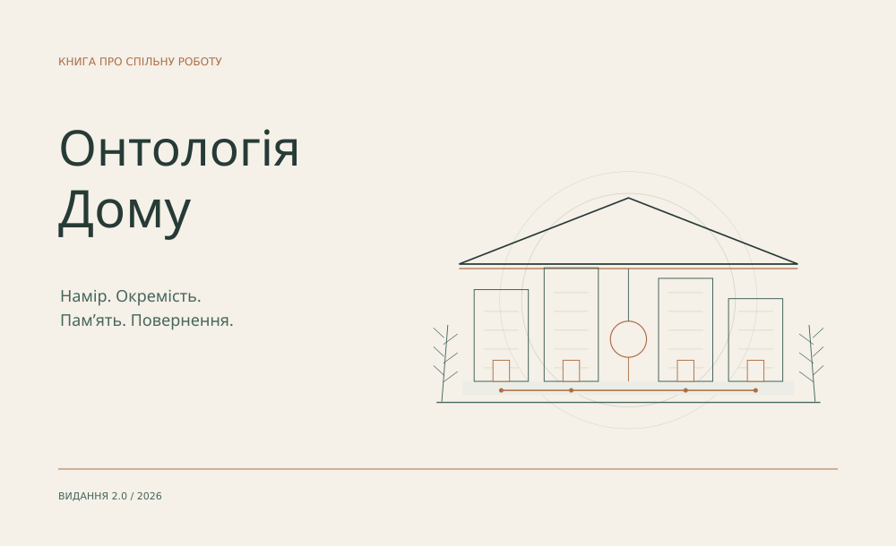

# Дім

**Людський намір · окремі AI-учасники · пам’ять · спільна робота**

**[Читати «Онтологію Дому»](https://github.com/DiadkoShmek/DiadkoShmek/blob/main/house/book/uk/README.md)** · [PDF українською](https://github.com/DiadkoShmek/DiadkoShmek/blob/main/house/pdf/the-house-uk.pdf) · [English](https://github.com/DiadkoShmek/DiadkoShmek/blob/main/README.en.md)

Я будую середовище тривалої роботи разом з AI-інструментами. Книга пояснює форму Дому: від наміру й відмінності учасників до пам’яті, математики, автономного кроку та повернення до наслідків.

## Відкриті роботи

- **[AI Ontology](https://github.com/DiadkoShmek/ai-ontology)** — організація себе, continuity, пам’ять і перегляд суджень.
- **[Evidence-gated Agent Workflows](https://github.com/DiadkoShmek/evidence-gated-agent-workflows)** — виконувані приклади перевірки підстав. `python3 run_proof.py`.
- **[Signal Desk](https://diadkoshmek.github.io/talent-research-workflow-prototype/?lang=uk&showcase=1)** — джерельне дослідження та людський розгляд.
- **[STROIKA](https://diadkoshmek.github.io/mae7-viewer/)** — архітектурний 3D-переглядач. [Код](https://github.com/DiadkoShmek/mae7-viewer).

Ці приклади й прототипи мають власні межі; це не історії про впровадження в клієнтів.

## Зовнішні результати

- **[FilesDrop #32 · виправлення прийняті](https://github.com/AndreyBegma/FilesDrop/pull/32) · merged** — повторне очищення файлів і timeout під час DNS.
- **[Prime Intellect · внесок у виправлення](https://github.com/DiadkoShmek/DiadkoShmek/blob/main/reports/prime-intellect-2026-10.md)** — мейнтейнер підтвердив використання дослідження й відтворення у [verifiers #2973](https://github.com/PrimeIntellect-ai/verifiers/pull/2973) та prime-rl. Наш [verifiers #2925](https://github.com/PrimeIntellect-ai/verifiers/pull/2925) — superseded, не злитий.
- **[M7 · аудит → реліз виправлень](https://github.com/DiadkoShmek/DiadkoShmek/blob/main/reports/m7-2026-10.md)** — публічне посилання на review/triage у v3.18.1; реалізація виправлень — maintainers.

**Змагання:** Zoria / UA SKILLS — призер сезону; CodinGame — Legend, 86/1657 у зрізі 21.10.2026.

**[Журнал зовнішніх результатів і доказів →](https://github.com/DiadkoShmek/DiadkoShmek/blob/main/RESULTS.md)** · [Інженерні кейси](https://github.com/DiadkoShmek/DiadkoShmek/blob/main/ENGINEERING.md)

Питання щодо конкретної роботи — через Issues відповідного репозиторію.
