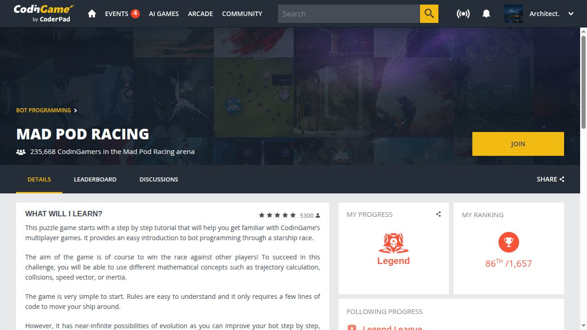

# External results

Open-source contributions, technical audits and competition results. Each entry names the date, contribution, external evidence and disposition. Engineering and investigation used AI tools.

[Українська](RESULTS.md) · [Case reports](reports/README.md) · [Machine-readable records](results.json)

## Contributions and audits

| Date | Project | Contribution | External outcome |
|---|---|---|---|
| 21 Oct 2026 | [FilesDrop](reports/filesdrop-2026-10.md#english-summary) | Two API reliability fixes and regression coverage | [PR #32 merged](https://github.com/AndreyBegma/FilesDrop/pull/32) |
| 24 Oct 2026 | [Prime Intellect · Verifiers / prime-rl](reports/prime-intellect-2026-10.md#english-summary) | Investigation, reproduction and a proposed patch | [Maintainer acknowledgement](https://github.com/PrimeIntellect-ai/verifiers/pull/2925#issuecomment-6385135636); maintainer implementation merged in both projects |
| 29 Oct 2026 | [M7 MCP](reports/m7-2026-10.md#english-summary) | Independent technical audit and focused follow-up | [Public review/triage credit in v3.18.1](https://github.com/DukeDeSouth/m7-mcp-oss/releases/tag/v3.18.1); fixes implemented by maintainers |

### FilesDrop

Expired-file cleanup retains failed removals for retry; URL-upload cancellation covers waiting for DNS. Our code was merged on 21 October. [Details and test scope](reports/filesdrop-2026-10.md#english-summary).

### Prime Intellect

The maintainer explicitly acknowledged that our reproduction and investigation shaped the fix. Their implementation was merged in [Verifiers #2973](https://github.com/PrimeIntellect-ai/verifiers/pull/2973) and [prime-rl #4243](https://github.com/PrimeIntellect-ai/prime-rl/pull/4243). Our [PR #2925](https://github.com/PrimeIntellect-ai/verifiers/pull/2925) was superseded and was not merged. Another contributor filed the original issue. [Contribution and design trade-off](reports/prime-intellect-2026-10.md#english-summary).

### M7

The project published a known-issues roadmap and its first maintenance release after an external review. The [source-pinned sprint document](https://github.com/DukeDeSouth/m7-mcp-oss/blob/6625fce7e07b4e5ba99fe0572b05a3d6c7b96ca0/docs/COMMUNITY_SPRINT.md) credits DiadkoShmek for review context. Our contribution is audit and triage; the maintainers implemented the fixes. [Audit, original PDF and follow-up boundaries](reports/m7-2026-10.md#english-summary).

## Competitions and arenas

| Observation date | Event | Result | Scope |
|---|---|---|---|
| 21 Oct 2026 | CodinGame · Mad Pod Racing | Legend League · 86/1657 | Dated league-ranking snapshot |
| Checked 27 Oct 2026 | Zoria 2026 · UA SKILLS | Season prize winner | Organizer announcement; exact final placement not established here |
| 19 Oct 2026 | Zoria 2026 | 5/9 | Historical preliminary second-stage table |

### CodinGame · Mad Pod Racing

Account: [Architect.](https://www.codingame.com/profile/effff781bd270b96c3fddbba39a29b4a7099847). The result is **86 of 1657 within Legend League**, observed on 21 October 2026, Europe/Helsinki. It is a moving ranking, not a final tournament result, an all-player rank or a current-rank promise. Sources: [official arena](https://www.codingame.com/multiplayer/bot-programming/mad-pod-racing) and [leaderboard](https://www.codingame.com/multiplayer/bot-programming/mad-pod-racing/leaderboard).

### Zoria 2026 · UA SKILLS

UA SKILLS named `diadkoshmek` among five season prize winners in its [public organizer announcement](https://ua.linkedin.com/company/ua-skills), checked on 27 October. That check date is not asserted to be the publication date. This entry establishes prize-winner status without claiming an exact final rank or payment.

The separate [19 October preliminary table](https://zoria.net/news/#19102026-попередній-підсумок-другого-етапу) placed the account fifth among nine second-stage participants and excluded episode R3. It remains a preliminary record. Tournament code and operational material remain private.

## How this record grows

Each result retains a date, role, primary source and evidence boundary. Merged code, an investigation informing a maintainer's fix, and an acknowledged audit are distinct outcomes. Later releases and rechecks receive dated updates; Git retains earlier records. Local tests are not official competition results, and prize announcements are separate from payment.

[Profile](https://github.com/DiadkoShmek) · [Engineering cases](ENGINEERING.md)
