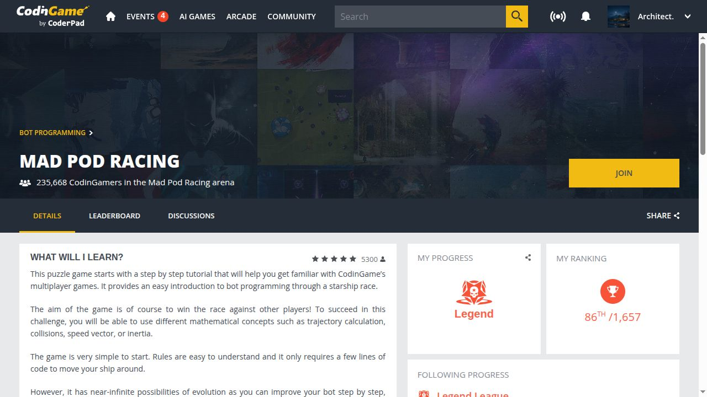

# Зовнішні результати

Внески у відкриті проєкти, технічні аудити й результати змагань. Кожен запис містить дату, внесок, зовнішнє джерело та фактичний статус. Реалізація й дослідження виконувалися з AI-інструментами.

[English](RESULTS.en.md) · [Інженерні кейси](ENGINEERING.md) · [Машиночитані записи](results.json)

## Внески та аудити

| Дата результату | Проєкт | Наш внесок | Зовнішній результат |
|---|---|---|---|
| 21.10.2026 | [FilesDrop](reports/filesdrop-2026-10.md) | Два виправлення API та регресійні перевірки | [PR #32 злитий](https://github.com/AndreyBegma/FilesDrop/pull/32) |
| 24.10.2026 | [Prime Intellect · Verifiers / prime-rl](reports/prime-intellect-2026-10.md) | Дослідження, відтворення помилки, запропонований patch | [Мейнтейнер підтвердив вплив на виправлення](https://github.com/PrimeIntellect-ai/verifiers/pull/2925#issuecomment-6385135636); його реалізація злита у двох репозиторіях |
| 29.10.2026 | [M7 MCP](reports/m7-2026-10.md) | Незалежний технічний аудит і перевірка першого пакета виправлень | [Реліз v3.18.1 публічно відзначає review/triage](https://github.com/DukeDeSouth/m7-mcp-oss/releases/tag/v3.18.1); реалізація — maintainers |

### FilesDrop · код прийнято

Очищення прострочених файлів зберігає невдалі видалення для повтору; deadline URL-upload діє також під час очікування DNS. **Наш PR #32 злитий 21 жовтня.** [Зміна й перевірки](reports/filesdrop-2026-10.md).

### Prime Intellect · дослідження використано у виправленні

Мейнтейнер прямо підтвердив, що наше дослідження й відтворення сформували виправлення. Його варіант злитий у [Verifiers #2973](https://github.com/PrimeIntellect-ai/verifiers/pull/2973) та [prime-rl #4243](https://github.com/PrimeIntellect-ai/prime-rl/pull/4243). Наш [PR #2925](https://github.com/PrimeIntellect-ai/verifiers/pull/2925) закритий як superseded, **не злитий**. Початкову задачу відкрив інший учасник. [Розбір внеску](reports/prime-intellect-2026-10.md).

### M7 · аудит дійшов до roadmap і релізу

Після зовнішнього review проєкт опублікував реєстр проблем, план виправлень і перший maintenance release. [План спринту на зафіксованому commit](https://github.com/DukeDeSouth/m7-mcp-oss/blob/6625fce7e07b4e5ba99fe0572b05a3d6c7b96ca0/docs/COMMUNITY_SPRINT.md) прямо посилається на DiadkoShmek. Наш внесок — аудит і review/triage; код виправлень написали maintainers. [Кейс, PDF та межі повторної перевірки](reports/m7-2026-10.md).

## Змагання й арени

| Дата результату | Змагання | Результат | Статус |
|---|---|---|---|
| 21.10.2026 | CodinGame · Mad Pod Racing | Legend League · 86/1657 у цій лізі | Зріз рухомого рейтингу |
| 27.10.2026, перевірено | Zoria 2026 · UA SKILLS | Призер першого сезону | Оголошено організатором; без точного фінального місця |
| 19.10.2026 | Zoria 2026 | 5/9 у попередньому загальному підсумку | Попередній, не фінальний |

## CodinGame · Mad Pod Racing

- **Акаунт:** [Architect.](https://www.codingame.com/profile/effff781bd270b96c3fddbba39a29b4a7099847).
- **Формат:** постійна арена bot programming.
- **Зафіксовано:** 21.10.2026, Europe/Helsinki.
- **Результат:** Legend League, місце **86 із 1657 учасників ліги**. Це не місце серед усіх зареєстрованих у грі.
- **Джерело:** [офіційна арена](https://www.codingame.com/multiplayer/bot-programming/mad-pod-racing) і [рейтинг](https://www.codingame.com/multiplayer/bot-programming/mad-pod-racing/leaderboard).
- **Робота:** C++-бот для двох машин; локальні перевірки фізики й політики перед зіставленням з реальною ареною. Розробка з AI-інструментами.

Рейтинг змінюється з новими матчами й учасниками. Цей запис не є заявою про поточне місце на будь-яку майбутню дату або про найкраще місце за весь час.

## Zoria 2026 · підсумок UA SKILLS

**`diadkoshmek` — призер першого сезону Zoria.** Організатор UA SKILLS публічно назвав акаунт серед п’яти призерів у повідомленні про завершення сезону.

- **Що це:** інженерний турнір із системної розробки; робота над ігровим ботом, штабом керування та стратегією за обмежених ресурсів.
- **Організатор:** [UA SKILLS](https://ua-skills.com/).
- **Джерело:** [оголошення UA SKILLS про завершення першого сезону](https://ua.linkedin.com/company/ua-skills).
- **Перевірено:** 27.10.2026, Europe/Helsinki. Дата перевірки не підміняє дату публікації оголошення.

Оголошення підтверджує статус призера; точне місце у фінальній таблиці цим записом не встановлюється. Таблиця на `zoria.net/news/` на момент перевірки була недоступна. Раніше зафіксовані **5/9** нижче стосуються попереднього підсумку другого етапу. Суму нагороди й виплату тут не фіксую.

## Zoria 2026 · попередній підсумок

- **Акаунт:** `diadkoshmek`.
- **Формат:** турнір системної розробки, бот та ігровий штаб.
- **Результат відкритої таблиці від 19.10.2026:** **5-те місце серед 9 учасників другого етапу**.
- **Джерело:** [офіційний попередній підсумок](https://zoria.net/news/#19102026-попередній-підсумок-другого-етапу).
- **Перевірено:** 21.10.2026, Europe/Helsinki; у відкритому джерелі ще попередня таблиця.
- **Статус:** остаточний підсумок запланований на 21.10.2026, 18:00 UTC / 21:00 Europe/Helsinki.

Опублікована таблиця від 19.10 не включає оцінку епізоду Р3. Це історичний запис попереднього етапу, а не остаточна таблиця. Подальше оголошення організатора про призерів наведене окремо вище.

Код турнірного репозиторію та службові матеріали залишаються приватними; ця сторінка не є їх публікацією.

## Як поповнюється журнал

- Новий результат — новий датований запис; старі зрізи не переписуються на нові.
- Для внеску розрізняю власний merged patch, дослідження, використане в чужій реалізації, та аудит із зовнішнім підтвердженням.
- Зберігаю першоджерело, роль і автора реалізації. Новий реліз або повторна перевірка додає датоване уточнення; історичні дані залишаються доступними в Git.
- Для місця зазначаю арену або турнір, лігу/етап, дату, джерело й доступний доказ.
- Локальні тести та спаринги не називаю офіційними результатами.
- Нагороду фіксую після офіційного оголошення; отримання коштів — лише після фактичної виплати.

[Машиночитані записи](results.json) · [Профіль](https://github.com/DiadkoShmek)
