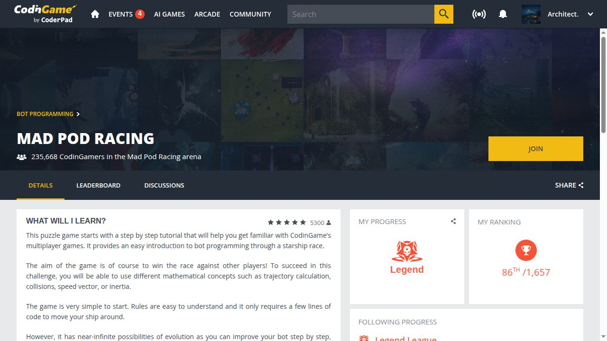

# Результати змагань

Датовані результати змагань і постійних арен. Для кожного запису зберігаю формат, джерело та статус. Процес розробки, гіпотези й негативні результати — в [інженерних звітах](ENGINEERING.md).

| Дата результату | Змагання | Результат | Статус |
|---|---|---|---|
| 21.10.2026 | CodinGame · Mad Pod Racing | Legend League · 86/1657 у цій лізі | Зріз рухомого рейтингу |
| 19.10.2026 | Zoria 2026 | 5/9 у попередньому загальному підсумку | Попередній, не фінальний |

## CodinGame · Mad Pod Racing

- **Акаунт:** [Architect.](https://www.codingame.com/profile/effff781bd270b96c3fddbba39a29b4a7099847).
- **Формат:** постійна арена bot programming.
- **Зафіксовано:** 21.10.2026, Europe/Helsinki.
- **Результат:** Legend League, місце **86 із 1657 учасників ліги**. Це не місце серед усіх зареєстрованих у грі.
- **Джерело:** [офіційна арена](https://www.codingame.com/multiplayer/bot-programming/mad-pod-racing) і [рейтинг](https://www.codingame.com/multiplayer/bot-programming/mad-pod-racing/leaderboard).
- **Робота:** C++-бот для двох машин; локальні перевірки фізики й політики перед зіставленням з реальною ареною. Розробка з AI-інструментами.

Рейтинг змінюється з новими матчами й учасниками. Цей запис не є заявою про поточне місце на будь-яку майбутню дату або про найкраще місце за весь час.

## Zoria 2026 · попередній підсумок

- **Акаунт:** `diadkoshmek`.
- **Формат:** турнір системної розробки, бот та ігровий штаб.
- **Результат відкритої таблиці від 19.10.2026:** **5-те місце серед 9 учасників другого етапу**.
- **Джерело:** [офіційний попередній підсумок](https://zoria.net/news/#19102026-попередній-підсумок-другого-етапу).
- **Перевірено:** 21.10.2026, Europe/Helsinki; у відкритому джерелі ще попередня таблиця.
- **Статус:** остаточний підсумок запланований на 21.10.2026, 18:00 UTC / 21:00 Europe/Helsinki.

Опублікована таблиця від 19.10 не включає оцінку епізоду Р3. Не подаю її як остаточну таблицю, підтверджений приз або отриманий дохід. Фінальний результат має бути окремим записом після офіційного оголошення.

Код турнірного репозиторію та службові матеріали залишаються приватними; ця сторінка не є їх публікацією.

## Як поповнюється журнал

- Новий результат — новий датований запис; старі зрізи не переписуються на нові.
- Для місця зазначаю арену або турнір, лігу/етап, дату, джерело й доступний доказ.
- Локальні тести та спаринги не називаю офіційними результатами.
- Нагороду фіксую після офіційного оголошення; отримання коштів — лише після фактичної виплати.

[Машиночитані записи](results.json) · [Профіль](https://github.com/DiadkoShmek)
