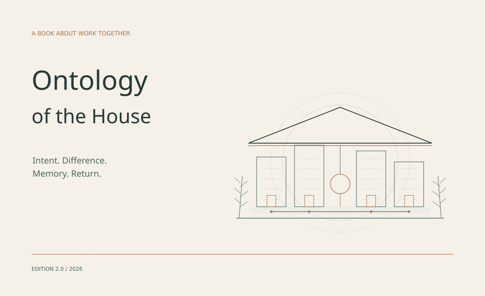

# Ontology of the House

Intent. Difference. Memory. Return.

[](pdf/the-house-en.pdf)

**[Read in English](book/en/README.md)** · **[English PDF](pdf/the-house-en.pdf)** · [Українська](README.md)

> What remains of work together when a conversation ends?

I build the House as an environment where human intent, distinct AI collaborators, memory and tools sustain work over time. This book explains why these parts belong to one whole, how difference is preserved, and how a consequence returns to the next decision.

## Four movements

**I. Being together.** Intent, the shape of the whole and distinct participants.

**II. Action and responsibility.** Autonomous steps, handovers and retained events.

**III. Memory and distinction.** Source retrieval, a neural experiment, state sufficiency, mathematics and revision.

**IV. Returning with a change.** Recovery, applied systems, research, craft and public work.

## Choose a reading edition

- [Book PDF](pdf/the-house-en.pdf) — A5, illustrations, contents and bookmarks.
- [Chapters on GitHub](book/en/README.md) — phone-friendly chapter navigation.
- [Continuous text](book/en/BOOK.md) — one page without a download.
- [Українська](book/uk/README.md) · [Український PDF](pdf/the-house-uk.pdf).

22 chapters and two source appendices. The conceptual account leads into concrete mechanisms: addressed memory, a local model layer, a character-level GRU, exact finite models, recovery and revision-bound work packages. The [source index](EVIDENCE.md) identifies the kind and limit of each evidence basis.

<details>
<summary>Authoring source and PDF reproduction</summary>

Manuscript: `book/manuscript.json`. Original vector plates and layout: `tools/`. Python 3.10+, ReportLab and installed DejaVu Sans/Serif fonts.

```bash
cd house
python -m pip install -r requirements.txt
python -B tools/figures.py --output-root .
python -B tools/build.py
python -B tools/check.py
```

After dependencies are installed, the scripts reproduce this edition offline. They do not start a private runtime or require a model.

</details>

Edition 2.0 · 29 October 2026. [Publication scope and rights](NOTICE.md).
