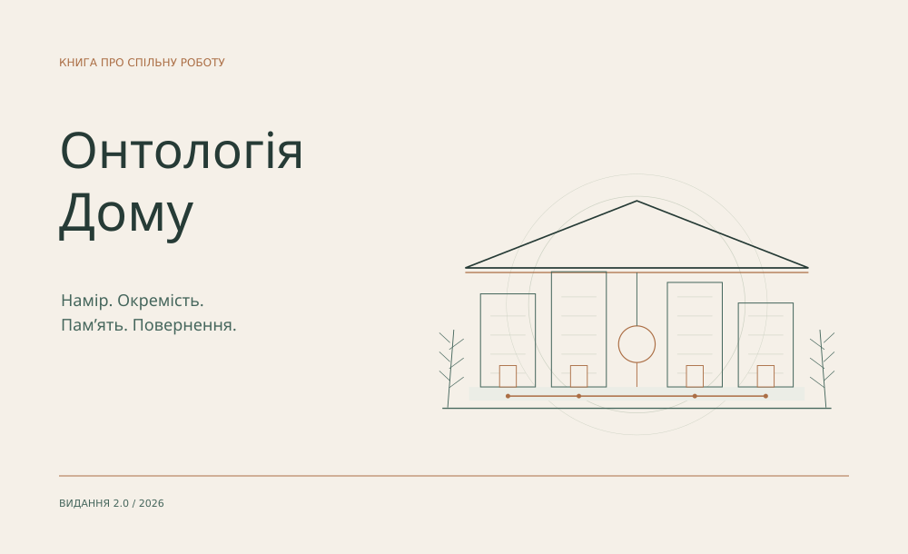

# Онтологія Дому

Намір. Окремість. Пам’ять. Повернення.

[](pdf/the-house-uk.pdf)

**[Читати українською](book/uk/README.md)** · **[PDF українською](pdf/the-house-uk.pdf)** · [English edition](README.en.md)

> Що лишається від спільної роботи, коли розмова закінчилася?

Я будую Дім як середовище, у якому людський намір, різні AI-учасники, пам’ять та інструменти підтримують довгу роботу. Ця книга пояснює, чому ці частини належать одному цілому, як зберігається відмінність і як наслідок повертається в наступне рішення.

## Чотири рухи

**I. Бути разом.** Намір, форма цілого й окремість учасників.

**II. Діяти й відповідати.** Автономний крок, передача роботи й збереження події.

**III. Пам’ятати й розрізняти.** Пошук підстав, нейромережевий дослід, достатність стану, математика та перегляд судження.

**IV. Повертатися зі зміною.** Відновлення, прикладні системи, дослідження, творчість і відкритий результат.

## Обери спосіб читання

- [Книжковий PDF](pdf/the-house-uk.pdf) — A5, ілюстрації, зміст і закладки.
- [Розділи на GitHub](book/uk/README.md) — читання з телефона й переходи між розділами.
- [Суцільний текст](book/uk/BOOK.md) — одна сторінка без завантаження.
- [English](book/en/README.md) · [English PDF](pdf/the-house-en.pdf).

22 розділи та два джерельні додатки. Поняттєвий текст переходить у конкретні механізми: адресну пам’ять, локальний модельний шар, символьну GRU, точні скінченні моделі, відновлення та прикладні робочі комплекти. Вид і межу кожної джерельної опори пояснено в [покажчику](EVIDENCE.md).

<details>
<summary>Джерела видання та відтворення PDF</summary>

Рукопис: `book/manuscript.json`. Власні векторні ілюстрації й верстка: `tools/`. Python 3.10+, ReportLab і системні шрифти DejaVu Sans/Serif.

```bash
cd house
python -m pip install -r requirements.txt
python -B tools/figures.py --output-root .
python -B tools/build.py
python -B tools/check.py
```

Скрипти відтворюють видання офлайн після встановлення залежностей. Вони не запускають приватний runtime і не потребують моделі.

</details>

Видання 2.0 · 29 жовтня 2026. [Межі публікації й права](NOTICE.md).
