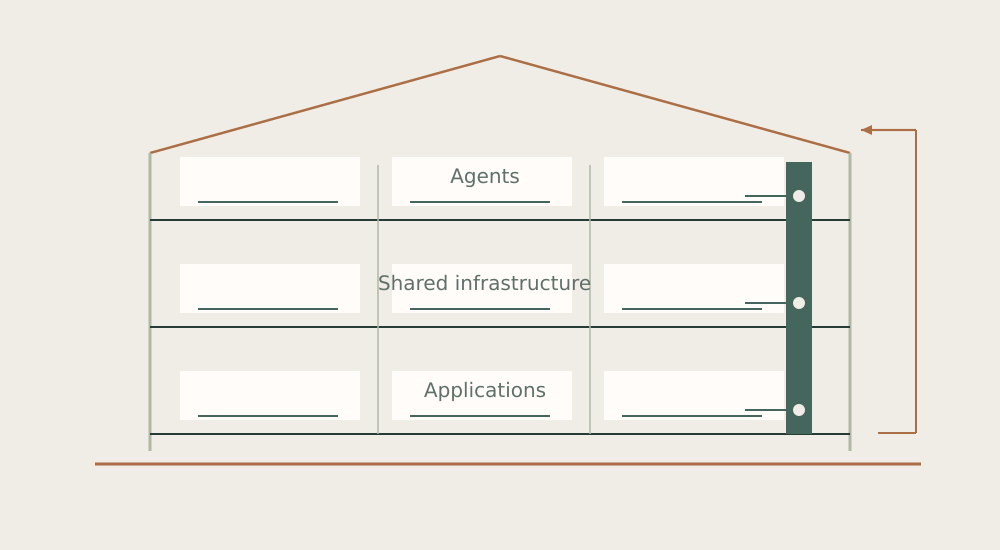

# The House

## Architecture for autonomous work

[Profile](https://github.com/DiadkoShmek) · [Українська](README.uk.md) · [Read the book](book/en/README.md) · [English PDF](pdf/the-house-en.pdf) · [Український PDF](pdf/the-house-uk.pdf)



I build the House as an environment for sustained autonomous work with AI: distinct collaborators, shared memory, local model tools, mathematical research and practical projects.

This book opens the architecture I use. It follows work from intent through ownership, execution and review, then into memory and the next decision. It explains Pole’s retrieval and neural experiments, the mathematics of information loss, cooperative agent work, recovery, Mirror and Budova.

### Read

- [22 chapters and two reference appendices](book/en/README.md)
- [Single-page Markdown edition](book/en/BOOK.md)
- [Ukrainian edition](book/uk/README.md)
- [Evidence basis and boundaries](EVIDENCE.md)

### Inside

- Distinct agent homes, orchestration leases, durable mail and shared work.
- Source-addressed memory, BM25, graph expansion and lexical evidence checks.
- An in-house NumPy character GRU, manual BPTT/Adam and retained training artifacts.
- Sufficient-state mathematics, invariants, counterexamples and exact finite models.
- Local support-model lifecycle, transactional state, recovery and immutable work packages.
- Quantitative experiments, revision-bound construction work, interfaces and creative pipelines.

### Rebuild the publication

Python 3.10+ and DejaVu Sans fonts.

```bash
cd house
python -m pip install -r requirements.txt
python -B tools/figures.py --output-root .
python -B tools/build.py
python -B tools/check.py
```

Use `--font-dir PATH` if DejaVu Sans is not installed. The scripts have no model, network or private-runtime dependency. They rebuild the book and its illustrations; they do not install the private House systems.

I develop the project with AI collaborators. Specific contributions retain attribution; foundation models, OpenClaw and libraries retain their upstream provenance.

Edition 1.0 ·28 October 2026. [Publication scope](NOTICE.md).
