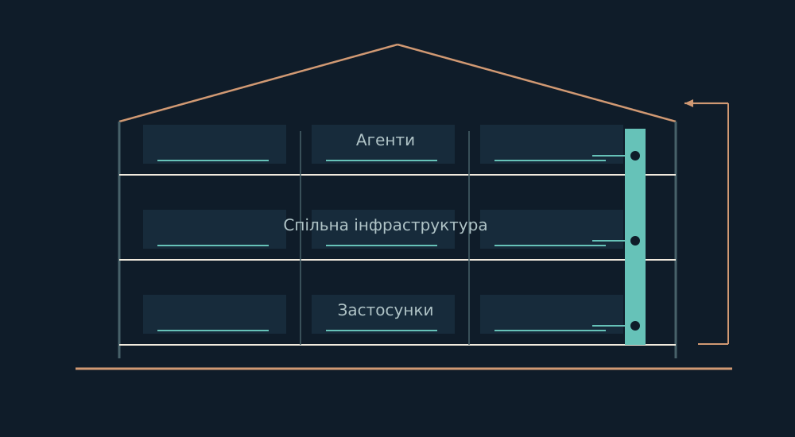

# Дім

## Архітектура автономної роботи

[Профіль](https://github.com/DiadkoShmek) · [English](README.md) · [Читати книгу](book/uk/README.md) · [PDF українською](pdf/the-house-uk.pdf) · [PDF англійською](pdf/the-house-en.pdf)



Я будую Дім як середовище тривалої автономної роботи разом з AI: окремі виконавці, спільна пам’ять, локальні модельні інструменти, математичні дослідження й прикладні проєкти.

Ця книга відкриває архітектуру, якою я користуюся. Вона веде від наміру через власність, виконання й перевірку до пам’яті та наступного рішення. Пояснює пошук і нейромережеві досліди Поля, математику втрати інформації, співпрацю агентів, відновлення, Дзеркало й Будову.

### Читати

- [22 розділи й два джерельні додатки](book/uk/README.md)
- [Суцільна Markdown-версія](book/uk/BOOK.md)
- [Англійська версія](book/en/README.md)
- [Джерельна основа та межі](EVIDENCE.md)

### Усередині

- Окремі доми агентів, leases оркестрації, durable-пошта й спільні справи.
- Адресна пам’ять, BM25, графове розширення та лексична звірка доказів.
- Власна символьна GRU на NumPy, ручні BPTT/Adam і збережені результати навчання.
- Математика достатнього стану, інваріанти, контрприклади й точні скінченні моделі.
- Життєвий цикл локальних моделей, транзакційний стан, відновлення й незмінні робочі комплекти.
- Кількісні досліди, будівельні ревізії, інтерфейси й творчі конвеєри.

### Відтворити публікацію

Python 3.10+ та шрифти DejaVu Sans.

```bash
cd house
python -m pip install -r requirements.txt
python -B tools/figures.py --output-root .
python -B tools/build.py
python -B tools/check.py
```

За потреби передай `--font-dir PATH` до DejaVu Sans. Скрипти не потребують моделі, мережі або приватного runtime. Вони відтворюють книгу та ілюстрації.

Я розвиваю проєкт разом з AI. Конкретні внески зберігають атрибуцію; базові моделі, OpenClaw і бібліотеки мають власне походження.

Редакція 1.0 ·28 жовтня 2026. [Межі публікації](NOTICE.md).
