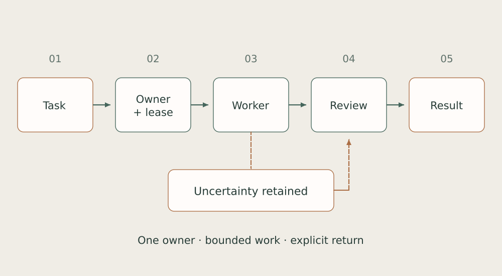

# 04. From intent to autonomous work

Autonomy needs a memory of unfinished work. Otherwise every interruption turns into another request for the human to decide what happens next.

*Work passes through ownership, admission, execution and acceptance. An uncertain effect remains explicitly uncertain.*

In the Lancet layer, the controller, lane registry and runtime are separate. The registry defines the task, owner and read/write scope. The dispatcher launches an admitted pending task. A recovery requirement must first acquire an exact repair or successor; it does not itself justify restarting everything.

A lease is stored before the effect: task generation, slot and process epochs, source version and deadline. A missing PID does not prove that an action never occurred. Executor termination, candidate output and acceptance have separate records. This reduces the risk of repeating an action whose reply was lost.

Evidence basis: [B02](../../EVIDENCE.md#b02).

← [Previous](03-homes.md) | [Next](05-events.md) →
