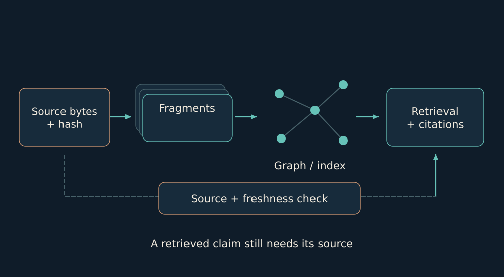

# 06. Memory with coordinates

I want to return to the basis of a thought: where it came from, which bytes were read, and what changed afterwards.

*A file, fragment, record and projection serve different roles. An index helps locate a source.*

HouseMemory on Neo4j is an addressed map: owner, path, source hash, symbols and explicit links. It helps locate the correct code or an earlier reason for a decision. Graph status describes index coverage. I check current behavior with the runtime owner because a projection can lag behind.

Another layer is the event and work journal. It retains actor, review, revision and acceptance state. An agent’s home holds its own materials. The library provides navigation to books and research. These kinds of memory complement each other without silently replacing their sources.

A separate continuity bridge publishes the consequence return and next projection behind one head. The reader captures that head once. This avoids a mixed pair in which one file is new while the other still belongs to an earlier generation.

Evidence basis: [B03](../../EVIDENCE.md#b03), [B04](../../EVIDENCE.md#b04), [B11](../../EVIDENCE.md#b11).

← [Previous](05-events.md) | [Next](07-pole-memory.md) →
