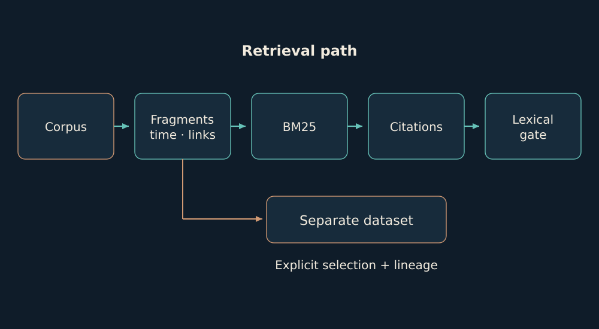

# 07. Pole: retrieval with a source

Pole has its own memory stack. I describe it as a sequence of concrete transformations rather than hiding it behind the word RAG.

When I question memory, I want not only an answer but a way to check it. Retrieval gathers fragments that may be relevant; links help me reach neighboring context. This is the beginning of reading, not the end of reasoning.

A query about an interrupted repair may find both a proposal and a later record of acceptance. Similar words help retrieve both texts, but do not establish that the second really concerns the first. That relation has to be read and checked.

The formula below describes ranking: a more frequent term can strengthen a match, a rarer one can be more discriminating, and document length is accounted for separately. The score helps decide what to read first; it does not turn retrieved text into truth.

*Provenance → fragments → time and links → retrieval → citations → lexical checks.*

The scanner records sources; the fragmenter adds coordinates and the parent-file hash; the temporal layer distinguishes recording order from authorship. The graph contains explicit links. BM25 retrieval normalizes numbers and Cyrillic prefixes and ranks fragments by term frequency, rarity and document length.

$$
\operatorname{score}(q,d)=\sum_{t\in q}\operatorname{IDF}(t)\frac{f(t,d)(k_1+1)}{f(t,d)+k_1(1-b+b|d|/\overline{|d|})}
$$

Graph expansion adds neighboring references. The gate compares sentence words with cited fragments, query coverage and citation agreement with retrieval, retaining the first failure. This is a lexical check. It can expose unsupported drafts, but it does not establish logical entailment. Likewise, stored index hashes need current-byte validation before consequential use.

Evidence basis: [B04](../../EVIDENCE.md#b04).

← [Previous](06-memory.md) | [Next](08-data.md) →
