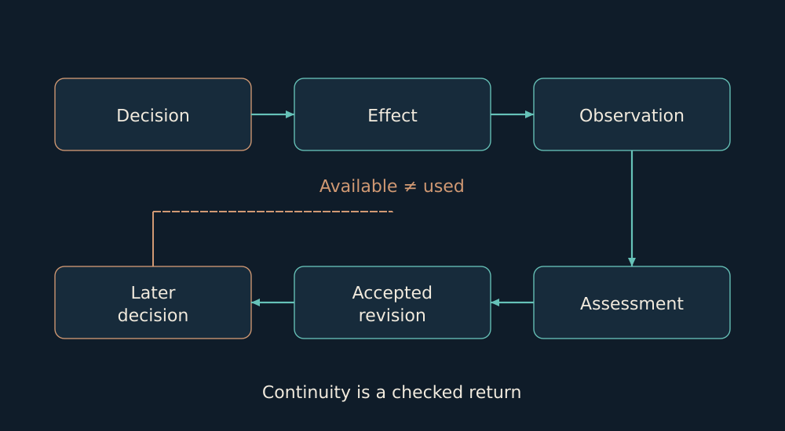

# 15. Revising a judgment and continuity

I want to see what actually changed after experience. A stored lesson is only one possible trace.

I care not only whether a lesson was saved, but whether it changed the next decision. Between a record and an action lies a path: the record must be found, understood, applied to the relevant situation and followed to its consequence. Each transition can fail.

If after an interruption I find a note saying “check acceptance,” that does not mean the check happened. And if it happened, the next question is whether it changed how work continued. Such distinctions make the word “learned” meaningful rather than merely complimentary.

I also want to name in advance what could disprove my judgment. Then a later success does not erase an earlier incomplete attempt, and observation has a chance to change my position. Without such a return, memory merely accumulates words.

*The return path connects an effect to an accepted revision and a later decision. It is a record criterion.*

In AI Ontology I separate available evidence from a record actually used; adoption of a criterion from satisfaction; a stored lesson from formation; and a recorded effect from a complete return path. These distinctions keep a concrete process from disappearing inside the word learned.

The public reference contains a finite record model, relations, competency queries, projections and JSON/JSONL auditing. Book version 3.7.0 connects conceptual chapters, executable code, studies and a claim ledger. Its proposed audit profile has explicit bounds; I do not present it as an adopted industry standard.

A separate prospective evaluator freezes the thesis, counterthesis, horizon and falsifier before the outcome. The cohort stays fixed: an unresolved early attempt cannot be replaced by a later success. This implements prospective evaluation; a full natural-use cycle and benefit on subsequent tasks are assessed separately.

Evidence basis: [B10](../../EVIDENCE.md#b10), [B11](../../EVIDENCE.md#b11).

← [Previous](14-shadow.md) | [Next](16-runtime.md) →
