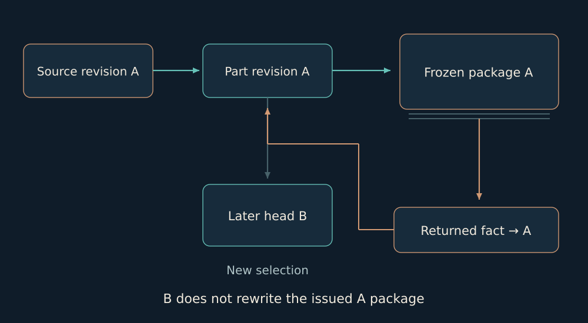

# 18. Budova: exact revisions for physical work

A foreman or installation crew lead should be able to see on a phone which work package was handed over, which revision it belongs to and what remains unknown.

I want shared work to leave the conversation and become something a person can act on. In a construction example, that means a package showing the revision actually handed over, its details and what remains unknown. Clarity has a practical consequence here.

If a new measurement appears after handoff, the old package must not silently change. Otherwise two people may use the same name while holding different facts. A revision binding lets them ask: what exactly was handed over then, and what changed afterwards?

A local run can show that a package is created and recovered under tested conditions. It does not yet show how a professional will use it in real work. I leave room for that trial, because that is where clarity meets practice.

*An issued package and a returned fact remain attached to their revision even after the current head advances.*

Sources, part geometry and issued packages have distinct immutable bindings. The model contains exact outlines and holes, units, DXF/maps and original CAD sources. A new measurement does not rewrite a package already handed over.

Project saves use transactional CAS. Exact request replay is checked before a revision conflict. Background export passes through staging, a recovery record, fsync and rename. A historical fact passes preview and CAS before being appended to its own revision. Old cumulative progress must not become a fresh increment merely because a request was retried.

Local UI/HTTP flows already issued a package with 18 members and two CAD originals, and served the same frozen ZIP after controlled loss of a live source. A professional user trial and the latest served-origin acceptance of the montage reader remain specific boundaries of this product.

Evidence basis: [B13](../../EVIDENCE.md#b13).

← [Previous](17-mirror.md) | [Next](19-science.md) →
