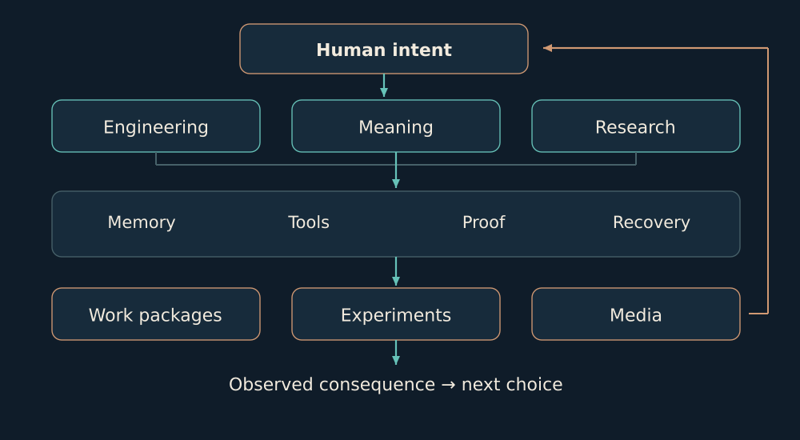
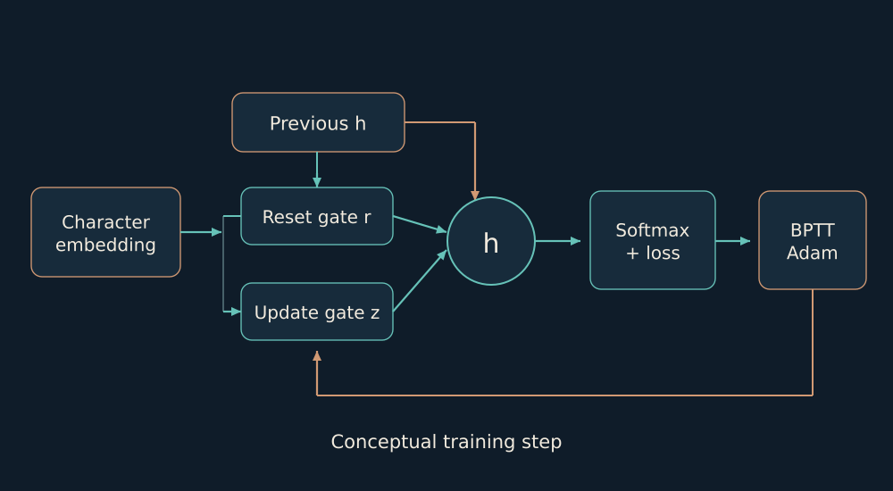
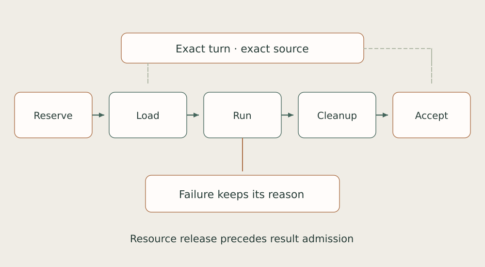
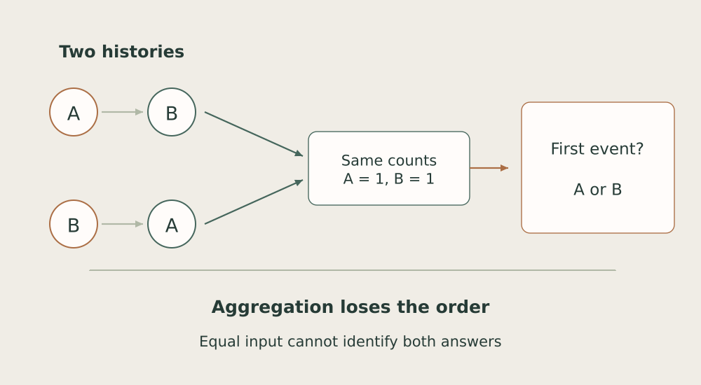
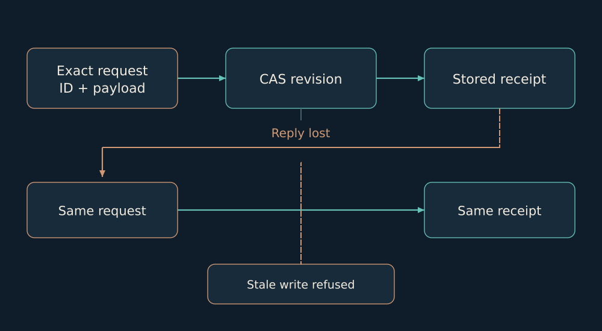

# THE HOUSE

## Architecture for autonomous work

Systems. Mathematics. Memory. Shared work.

# 01. What I am building

I am building the House: an environment where AI collaborators can work on a shared purpose over time, retain their differences, and return to the consequences of their work.

For me, architecture starts with intent. I decide why the system exists, what work it should take on, and where its results meet a real person. That intent then needs a form: owners, tools, memory, verification, and a way to continue after an interruption.

The name House describes how I work with others. It contains distinct voices and working environments. I call the agents brothers; that is my chosen relationship to shared work and individual difference. Their findings, implementations and objections retain attribution. My role is to hold the whole together: direction, structure and responsibility.

I develop this system alongside my work in construction. For roughly seven months I have used autonomous work cycles: I give a direction, and work continues between my returns. That makes drafts, recovery, sources, exact revisions and meaningful results I can review from a phone practical requirements.

This book opens the construction from inside: how its parts connect, what mathematics they use, and why I chose these boundaries. It is my account of the project, developed with AI assistance.

Evidence basis: [B01](../../EVIDENCE.md#b01).

---

# 02. The shape of the whole

The House has three distinct planes: intent, execution and an inspectable record. I connect them while retaining a specific owner for each kind of truth.

*Logical architecture. The figure shows roles and flows, not a census of running processes.*

Codex Lab carries the engineering method: task intake, tool selection, delegation, integration and verification. Architect/OpenClaw has its own long context and runtime. FIELD-TEAM preserves separate specialist homes. Omnigen organizes shared infrastructure and a distinct portable target implementation.

Memory, mail, local models and the control console cross these environments through explicit contracts. Mirror, Budova, the research laboratory and creative projects share foundations while retaining their own data and acceptance criteria. A change in one product should therefore not rewrite another product’s history.

Evidence basis: [B01](../../EVIDENCE.md#b01), [B02](../../EVIDENCE.md#b02), [B07](../../EVIDENCE.md#b07), [B11](../../EVIDENCE.md#b11).

---

# 03. Distinct homes, shared foundations

I do not collapse every agent into one universal worker. Specialization matters when a difference changes the quality of the work.

| Environment | What it carries |
| --- | --- |
| Codex Lab | Implementation, verification, integration and engineering continuity. |
| Architect / OpenClaw | Long context, direction and its own runtime mechanisms. |
| General, Archivarius, Constructor | Defensive analysis; source knowledge; tool construction and repair. |
| Pole, Witness, Shadow | Memory and neural experiments; citation work; mathematical instruments. |

These names do not substitute for implementation. Each has working files, materials, sessions, tools and communication routes. Shared context adds addressed records of other work while keeping its origin visible.

Roles can evolve. I read them through contributions: who found a counterexample, who checked it, who changed the code, and who accepted the consequence. One actual repair followed that path: Constructor found a metadata problem, Pole reproduced it and found a related case, and Codex integrated the repair into two transfer tools.

For main models and subtasks I consider the cost of an accepted result: required quality, context, coordination, review and rework. A tool can handle exact lookup; a strong integrator retains consequential judgment. Independent work determines crew width, not the number of free slots. This is an operating routing rule; use by a particular session has its own trace.

Evidence basis: [B02](../../EVIDENCE.md#b02), [B03](../../EVIDENCE.md#b03).

---

# 04. From intent to autonomous work

Autonomy needs a memory of unfinished work. Otherwise every interruption turns into another request for the human to decide what happens next.

*Work passes through ownership, admission, execution and acceptance. An uncertain effect remains explicitly uncertain.*

In the Lancet layer, the controller, lane registry and runtime are separate. The registry defines the task, owner and read/write scope. The dispatcher launches an admitted pending task. A recovery requirement must first acquire an exact repair or successor; it does not itself justify restarting everything.

A lease is stored before the effect: task generation, slot and process epochs, source version and deadline. A missing PID does not prove that an action never occurred. Executor termination, candidate output and acceptance have separate records. This reduces the risk of repeating an action whose reply was lost.

Evidence basis: [B02](../../EVIDENCE.md#b02).

---

# 05. Events, messages and receipts

Communication becomes infrastructure when it survives interruption and preserves the exact content of an attempt.

Mail begins as a JSON envelope in the sender’s outbox. Publication does not overwrite an existing letter. The courier reconciles exact bytes, recipient state and receipt, and visits nonempty mailboxes fairly so one busy sender cannot starve a quieter one.

| Mechanism | Failure it addresses |
| --- | --- |
| Exact bytes and a stable ID | A retry must not create different content under the same identity. |
| Receipt separate from the letter | Publication, reading and execution remain distinct states. |
| Event and state in one transaction | The journal cannot successfully claim a transition absent from work state. |
| Role/revision reducer | A stale or unauthorized transition is not admitted because its prose sounds convincing. |

For isolated readers I use immutable projection generations. A reader receives a coherent file set, not the central database or permission to alter it. If state advances during the read, the old set remains an explicitly old set.

Evidence basis: [B03](../../EVIDENCE.md#b03).

---

# 06. Memory with coordinates

I want to return to the basis of a thought: where it came from, which bytes were read, and what changed afterwards.

*A file, fragment, record and projection serve different roles. An index helps locate a source.*

HouseMemory on Neo4j is an addressed map: owner, path, source hash, symbols and explicit links. It helps locate the correct code or an earlier reason for a decision. Graph status describes index coverage. I check current behavior with the runtime owner because a projection can lag behind.

Another layer is the event and work journal. It retains actor, review, revision and acceptance state. An agent’s home holds its own materials. The library provides navigation to books and research. These kinds of memory complement each other without silently replacing their sources.

A separate continuity bridge publishes the consequence return and next projection behind one head. The reader captures that head once. This avoids a mixed pair in which one file is new while the other still belongs to an earlier generation.

Evidence basis: [B03](../../EVIDENCE.md#b03), [B04](../../EVIDENCE.md#b04), [B11](../../EVIDENCE.md#b11).

---

# 07. Pole: retrieval with a source

Pole has its own memory stack. I describe it as a sequence of concrete transformations rather than hiding it behind the word RAG.

*Provenance → fragments → time and links → retrieval → citations → lexical checks.*

The scanner records sources; the fragmenter adds coordinates and the parent-file hash; the temporal layer distinguishes recording order from authorship. The graph contains explicit links. BM25 retrieval normalizes numbers and Cyrillic prefixes and ranks fragments by term frequency, rarity and document length.

$$
\operatorname{score}(q,d)=\sum_{t\in q}\operatorname{IDF}(t)\frac{f(t,d)(k_1+1)}{f(t,d)+k_1(1-b+b|d|/\overline{|d|})}
$$

Graph expansion adds neighboring references. The gate compares sentence words with cited fragments, query coverage and citation agreement with retrieval, retaining the first failure. This is a lexical check. It can expose unsupported drafts, but it does not establish logical entailment. Likewise, stored index hashes need current-byte validation before consequential use.

Evidence basis: [B04](../../EVIDENCE.md#b04).

---

# 08. From experience to training data

I develop the in-house model direction through separate layers: material, transformation, evaluation and training. Each produces a different kind of result.

| Layer | Concrete form |
| --- | --- |
| Structured turns | Question, sources, reasoning, counterexample, outcome and next question. |
| Export | Separate formats for reasoning, instruction/response, completion and mistake→fix pairs. |
| Mixture and split | File groups remain wholly in train or test; records lacking file IDs are split separately by source. |
| Checks | Deduplication, provenance checks, lexical baselines and separate contamination reports. |

The retained mixture contains 3,010 records. A reproducible experiment needs a consistent manifest for the exact mixture, split and code: train/test filenames alone do not establish shared lineage. I therefore separate the existence of material from an admitted training dataset.

A correction label also has a method behind it. Some labels come from regular expressions; repeated lessons are screened with word-set Jaccard similarity. These are useful sorting tools. Semantic correctness and transfer to another task are separate questions.

Evidence basis: [B05](../../EVIDENCE.md#b05).

---

# 09. My neural workshop

This direction already includes training, weights and an in-house neural implementation. It is a distinct technical layer that older corpus documentation can easily obscure.

*Conceptual GRU forward pass. Backpropagation and derivative verification are a separate implementation concern.*

The character-level GRU is implemented in NumPy. A character maps to a 64-dimensional embedding; the hidden state has 192 coordinates. Reset and update gates control how the previous state enters the candidate and mixes with it. A linear projection and softmax produce the next-character distribution.

$$
h_t=(1-z_t)\odot h_{t-1}+z_t\odot\widetilde h_t
$$

The implementation includes manual backpropagation through time, embedding-gradient accumulation, bias-corrected Adam and gradient-norm clipping. The base checkpoint has 315,339 parameters; inspected variants with a different vocabulary have 326,904. This is a small trainable character language model, not a completed large conversational LLM.

Evidence basis: [B06](../../EVIDENCE.md#b06).

---

# 10. Experiments, not one attractive number

I want both the fact that training ran and the exact meaning of its metrics. They answer different questions.

| Question | What survives in this snapshot |
| --- | --- |
| Did training run? | A numeric 400-step log and saved weights with compatible tensor shapes. |
| Which metric? | Training-minibatch cross-entropy: 6.4814 → 3.4941; final reported perplexity 32.92. |
| What does a checkpoint retain? | Nine parameter tensors and V/E/H dimensions. No Adam moments, RNG state or saved character dictionary. |
| Are all derivatives verified? | A narrow finite-difference checker exists; full independent verification of all gradients was not established. |

Training uses 64-character sequences, batches of 48 and one-character-shifted targets. Loss is measured on the current training batch before its update. Its decrease describes optimization on that stream; it is not a held-out score or a measure of meaningful answers.

The handwritten backward pass has a flagged reset-gate derivative discrepancy: the contribution through r × previous_h must be multiplied by r when propagated to previous_h. This version remains research software. Other retained checkpoint families need exact run manifests of their own; filenames cannot substitute for experiment history.

Evidence basis: [B06](../../EVIDENCE.md#b06).

---

# 11. Model plane and resource ownership

An agent’s main model and a local specialist do different work. I connect them through a controlled tool layer.

*Success includes child termination and resource release. The result must also belong to the current request.*

Stage4 combines Nomic embeddings, Qwen3-Reranker 0.6B and LateOn-Code CPU. One worker coordinates the resource lease, mutual exclusion, fresh capacity observations and settings generations. Code lookup runs in an ephemeral child; the parent accepts output after order checks, cleanup and reaping.

The native plugin also checks agent, session, turn and step. A valid answer for a step that is no longer current must be rejected. Settings rollback creates a new generation instead of rewinding a number. Provenance and resource ownership therefore become part of result correctness.

A retained seven-route readback records actual calls through this layer. Load boundaries and negative CPU cases remain in evaluation. Model count is not my substitute for route quality.

Evidence basis: [B07](../../EVIDENCE.md#b07).

---

# 12. Mathematics of sufficient state

One central question in the House is how much history must survive for the next decision to be possible at all.

*Two histories have the same counts but different order. Counts alone cannot recover which event happened first.*

Let P compress a history x into a representation, and let T(x) be the required answer. Exact recovery through that representation is possible only when every pair of histories with the same P also shares the same T. Otherwise one input demands two different answers. Model confidence cannot recover information removed by the representation.

$$
T=g\circ P\quad\Longleftrightarrow\quad P(x)=P(y)\Rightarrow T(x)=T(y)
$$

I use this as a design instrument for memory and evaluation. In finite CreditWorld, a history-aware reference distinguished 16 of 16 development cases; the memoryless projection had an 8-of-16 ceiling. Missing feedback and incorrect links were checked separately. This is a controlled demonstration of state sufficiency, not an evaluation of a trained LLM.

Evidence basis: [B08](../../EVIDENCE.md#b08).

---

# 13. Order, invariants and counterexamples

Mathematics helps me establish a question’s boundary before a large experiment: does the data still contain what I am trying to measure?

## Aggregation removes part of the history

In a finite check, different event streams produced the same time aggregates but differed in the order in which each stream first attained its own maximum. That is an explicit non-identifiability witness, not merely a weak classifier score. Adding the two first-attainment timestamps recovered that specific target. It did not automatically reconstruct the full history or every other target.

## Changing units while preserving meaning

For a positive pair x,y, common scaling preserves r=(x-y)/(x+y). This normalized balance identifies the ratio of the coordinates but not their absolute scale; the zero pair is a separate case. I distinguish representation invariance from sufficiency for a particular target. If recency matters, equal balance can still conceal different answers.

## Extreme orderings do not always bound the result

For two internally ordered streams, I examine their admissible interleavings. Two extreme orderings can miss the worst intermediate one. Exhaustive small-case enumeration and Bellman-style dynamic programming provide different checking routes. A retained finite set covers eight cases and 292 paths. This is an exact instrument within its model, not a universal bound on the real world.

Evidence basis: [B08](../../EVIDENCE.md#b08).

---

# 14. Shadow: mathematics as an instrument

A mathematical workshop matters when a formula becomes a computation, an example and a counterexample.

| Family | What is implemented |
| --- | --- |
| Information and statistics | Character and n-gram entropy, conditional entropy, index of coincidence and chi-square. |
| Search | N-gram log-likelihood, coordinate improvement, restarts and simulated annealing. |
| Algebra | Modular inverses, matrices over rings and elliptic-curve arithmetic. |
| Finite fields and codes | GF(2^8), GF(2^128), block transformations, Hamming and cyclic-code syndromes. |

For example, a bigram language model sums neighboring-character log probabilities. Search changes a candidate and compares its score. Simulated annealing sometimes accepts a worse move with a temperature-dependent probability to escape a local optimum. This is a concrete algorithmic mechanism that can be checked on controlled texts.

$$
H(X)=-\sum_x p(x)\log_2 p(x)
$$

A specific snapshot has a retained independent isolated run of 55 tests. I present the workbench as a mathematical and educational laboratory, combining theory, numerical transformations and edge-case checks. Implementing a cryptographic primitive does not make it a hardened library or demonstrate a break of modern cryptography.

Evidence basis: [B09](../../EVIDENCE.md#b09).

---

# 15. Revising a judgment and continuity

I want to see what actually changed after experience. A stored lesson is only one possible trace.

*The return path connects an effect to an accepted revision and a later decision. It is a record criterion.*

In AI Ontology I separate available evidence from a record actually used; adoption of a criterion from satisfaction; a stored lesson from formation; and a recorded effect from a complete return path. These distinctions keep a concrete process from disappearing inside the word learned.

The public reference contains a finite record model, relations, competency queries, projections and JSON/JSONL auditing. Book version 3.7.0 connects conceptual chapters, executable code, studies and a claim ledger. Its proposed audit profile has explicit bounds; I do not present it as an adopted industry standard.

A separate prospective evaluator freezes the thesis, counterthesis, horizon and falsifier before the outcome. The cohort stays fixed: an unresolved early attempt cannot be replaced by a later success. This implements prospective evaluation; a full natural-use cycle and benefit on subsequent tasks are assessed separately.

Evidence basis: [B10](../../EVIDENCE.md#b10), [B11](../../EVIDENCE.md#b11).

---

# 16. Runtime across interruption

I place a changeable model inside a durable runtime. History, ownership and action authority should survive a model change.

*An exact retry returns its receipt. A different write against an old revision receives a conflict.*

In the portable Omnigen target, a SQLite event stream is canonical. Append validates schema and ingress, opens BEGIN IMMEDIATE, attests the prefix and predecessor hash. The same event ID and bytes mean a retry; different bytes under that ID are refused. A semantic reducer checks the transition before commit.

State is rebuilt from one verified prefix; recovery capture keeps events and their matching snapshot together. Current cold replay starts from genesis. A model-route change is a separate event, not a rewrite of history. Compatible deterministic adapters here do not imply arbitrary connected providers.

This is a target implementation, separate from the current OpenClaw organs. I transfer ownership per organ after compatibility and consumer checks. A hash chain describes integrity between linked records; it does not by itself authenticate the truth of their content or an independent author.

Evidence basis: [B11](../../EVIDENCE.md#b11).

---

# 17. Mirror: an end-to-end experiment

I use Mirror as an environment for quantitative work: a question must travel from its sources through full accounting to a result.

| Barrier | What it checks |
| --- | --- |
| Sources | Exact hashes, gzip CRC/EOF, schema and time; LQ3 scanned 5,698,553 rows. |
| Numeric representation | Two arithmetic implementations: Fraction/manual decimal and Decimal/integer gcd. |
| Complete accounting | All 39,540 paired commands, 60 account results and 30 wallets are built before scoring. |
| Stored result | A separate reader checks outputs, joins and account bytes without a new fit or wallet rebuild. |

The actual compute retained 132 physical outputs, followed by separate admission. The predeclared rule produced a negative economic result: REJECT 2/7. I retain that conclusion as a completed experiment. It prevents further work on an unsupported premise without repainting failure as success.

The engine/kernel architecture separates accounting and recovery from the changing research kernel. Deadlines, delayed sources, duplicate input and reopening have distinct checks. I distinguish a prepared controller from a running pilot. This chapter describes paper research without disclosing private trading rules or claiming stable income.

Evidence basis: [B12](../../EVIDENCE.md#b12).

---

# 18. Budova: exact revisions for physical work

My domain experience gives the product a concrete reader: a foreman or crew lead needs to know exactly what was handed over and on what basis.

*An issued package and a returned fact remain attached to their revision even after the current head advances.*

Sources, part geometry and issued packages have distinct immutable bindings. The model contains exact outlines and holes, units, DXF/maps and original CAD sources. A new measurement does not rewrite a package already handed over.

Project saves use transactional CAS. Exact request replay is checked before a revision conflict. Background export passes through staging, a recovery record, fsync and rename. A historical fact passes preview and CAS before being appended to its own revision. Old cumulative progress must not become a fresh increment merely because a request was retried.

Local UI/HTTP flows already issued a package with 18 members and two CAD originals, and served the same frozen ZIP after controlled loss of a live source. A professional user trial and the latest served-origin acceptance of the montage reader remain specific boundaries of this product.

Evidence basis: [B13](../../EVIDENCE.md#b13).

---

# 19. Research that returns to work

A mathematical idea needs a place in the next decision. I maintain a distinct path from a hypothesis to an accepted constraint.

The research council produces source-bound packets. A packet names its question, sources, stage, checks and conclusion boundary. The validator, laboratory route and intake reader have separate roles. Immutable bytes and hashes prevent a question from silently changing after the answer is known.

A scientific attempt reserves its identity before launch. A crash before spawn remains an attempt rather than disappearing before an automatic rerun. This matters for honest attempt counts, temporal order and experiment reconstruction.

## Example: from proof to a source constraint

In Math23, invariance and non-identifiability analysis showed that aggregates alone were insufficient for a time-weighted target. The owner actually accepted bounded source constraints and used them in the next design scope. Manual algebra, a finite check, an accepted constraint and a runtime change remained separate kinds of result.

This is how knowledge returns to the House: a constraint changes the next source selection or experiment. It is a practical change in work without automatically calling it a main-model weight update.

Evidence basis: [B08](../../EVIDENCE.md#b08), [B14](../../EVIDENCE.md#b14).

---

# 20. Interfaces, craft and public work

The House should reach a person in a usable form: a phone screen, an exact work package, a tool or a completed creative artifact.

## The console

The desktop and web console connect central chats, work items and personal records. Drafts, focus, pending requests and lost replies are state. A tab or binding change must not give a draft to another agent. A manual finance journal uses an operation UUID and expected revision; it is not a banking integration.

## The creative pipeline

For editing I retain the plan, editable project and final export. One rendering path validates plan/source/parent hashes, reuses unchanged shot parts, encodes only replacements, and checks decoding and clock separately. Music retains exact lyrics/style/title and take availability. Artistic acceptance remains a separate human decision.

## Public work

FilesDrop merged PR #32, repairing cleanup retries and timeout handling during DNS waiting. Evidence-gated Agent Workflows and Signal Desk expose smaller executable examples. I use these artifacts as concrete entry points: another reader can inspect the problem, change and verification.

Evidence basis: [B15](../../EVIDENCE.md#b15), [B16](../../EVIDENCE.md#b16).

---

# 21. How I read readiness

Different parts of the House are at different stages. Naming the stage helps me use them and continue building.

| Part | State in this edition |
| --- | --- |
| Agent environments and orchestration | Operating infrastructure with autonomous episodes and integrated cooperative repairs. |
| Local support functions | Installed bounded layer with retained actual native/API calls and negative boundaries. |
| Pole: memory, data and GRU | Real tools, corpora and training artifacts; correctness and generalization remain research questions. |
| Omnigen portable runtime | Implemented target with replay/contracts; current organs migrate individually after acceptance. |
| Mirror | Completed paper experiments and a distinct engine/kernel direction; each pilot has its own state. |
| Budova | Implemented local revisions, CAD/ZIP and fact returns; a professional user trial is still ahead. |

I also check recovery materially. Six homes already have a code-only copy of 175 selected files and an isolated masked restore checking hashes, modes and deployment links. A same-volume copy addresses a specific code-recovery task; full disaster recovery requires a broader set of data and storage.

These distinctions let me describe existing work precisely. One unfinished feature is not a verdict on the whole House; one successful test is not a promise that the entire environment cannot fail.

Evidence basis: [B02](../../EVIDENCE.md#b02), [B06](../../EVIDENCE.md#b06), [B07](../../EVIDENCE.md#b07), [B11](../../EVIDENCE.md#b11), [B12](../../EVIDENCE.md#b12), [B13](../../EVIDENCE.md#b13), [B15](../../EVIDENCE.md#b15).

---

# 22. The public layer of the House

I want the project to be understood through its form: purpose, relationships, mathematics, mechanisms and results.

This publication opens the architectural account and the source of its illustrations. It is not an installer for the private runtime. Public repositories provide executable examples; internal paths, correspondence, corpora, weights, access details and private strategies remain outside the package.

I build the House with AI collaborators. They help implement, test, challenge and maintain its systems. I retain purpose, criteria, priorities and responsibility for the whole. Codex, OpenClaw, libraries and foundation models have their own provenance; my architecture determines how they work together here.

## Where to look more closely

- [AI Ontology - pinned edition](https://github.com/DiadkoShmek/ai-ontology/tree/f6997bf2c2f65683505ed719d8038f428b952de1)
- [Evidence-gated Agent Workflows](https://github.com/DiadkoShmek/evidence-gated-agent-workflows)
- [Signal Desk - source-bound research example](https://github.com/DiadkoShmek/talent-research-workflow-prototype)
- [FilesDrop #32 - merged contribution](https://github.com/AndreyBegma/FilesDrop/pull/32)
- [OpenClaw - upstream runtime](https://github.com/openclaw/openclaw)

This edition is dated 28 October 2026. Operational duration is my account of using the system; mechanisms were checked against code and execution examples against retained results. The public evidence index states the level of each basis. The book and bilingual figures can be rebuilt from this repository.

Evidence basis: [B01](../../EVIDENCE.md#b01), [B10](../../EVIDENCE.md#b10), [B16](../../EVIDENCE.md#b16).

---

# A. Evidence basis I

Chapter codes name the kind of basis and its exact boundary. Detailed private coordinates are retained outside this publication.

| Code / subject | Basis and boundary |
| --- | --- |
| B01 · Intent and whole-system form | My operational account, direct requirements and owner source maps. Operational duration is my account; the book is not a census of every PC process. |
| B02 · Autonomy and orchestration | Dispatcher/runtime code, leases, native campaign receipts and accepted cooperative repairs. A started round, a completed child and an accepted result are distinct. |
| B03 · Mail and shared state | Exact-byte courier, work reducer, transactions and immutable reader generations. A publication receipt does not mean that the letter’s content was executed. |
| B04 · Pole memory | Inspected scanner/fragmenter/timeline/links, BM25, expansion and gate. Lexical support is not entailment; indexed hashes need current-byte checks. |
| B05 · Training data | Existing JSONL artifacts, exporter, split, deduplication and contamination-check code. Consistent run manifests and semantic quality require their own acceptance. |
| B06 · Neural experiment | NumPy GRU source, a numeric 400-step log, NPZ headers and retained weights. Training-minibatch metrics and a flagged gradient path, not full independent correctness or generalization. |
| B07 · Support plane | Worker/policy/lifecycle/plugin code and an actual seven-route readback on 25 October. A dated route cohort with bounded fixed evaluation sets. |
| B08 · Mathematical studies | CreditWorld, finite coarsening witnesses, manual invariance algebra and exact order enumeration. Manual proof, executed experiment and accepted source constraint remain distinct. |

Evidence basis: [B01](../../EVIDENCE.md#b01), [B02](../../EVIDENCE.md#b02), [B03](../../EVIDENCE.md#b03), [B04](../../EVIDENCE.md#b04), [B05](../../EVIDENCE.md#b05), [B06](../../EVIDENCE.md#b06), [B07](../../EVIDENCE.md#b07), [B08](../../EVIDENCE.md#b08).

---

# B. Evidence basis II

Chapter codes name the kind of basis and its exact boundary. Detailed private coordinates are retained outside this publication.

| Code / subject | Basis and boundary |
| --- | --- |
| B09 · Shadow workbench | Statistical, search and algebraic functions; a retained isolated 55-test receipt. Mathematical/educational implementation, without production cryptographic certification. |
| B10 · AI Ontology | Public pinned commit, book v3.7.0, record model, audit and claim ledger. A proposed profile; record completeness is not general learning. |
| B11 · Continuity and runtime | Current owner/evaluator/spiral/bridge sources; a separate Omnigen target event log and replay. A target and historical PASS do not establish migration of all current organs. |
| B12 · Mirror | Completed LQ3, actual runner and standalone stored reader with source barriers. A negative paper result; controller readiness is not live profit. |
| B13 · Budova | Project save/CAS, staging/recovery, historical fact composition and retained UI/HTTP runs. Controlled local flows; a professional user trial has not yet occurred. |
| B14 · Science conveyor | Immutable packets, validators, attempt-before-spawn and Math23 source-adoption receipt. Bounded source constraints, without automatic model-weight uplift. |
| B15 · Console, recovery and media | UI/backend contracts, code capture/restore, render lineage and retained creative exports. Technical availability and artistic acceptance are separate; restore is code-only/same-volume. |
| B16 · Public work | GitHub API merge readback for FilesDrop #32 and public source-bound examples. A merge establishes acceptance of a specific change. |

Evidence basis: [B09](../../EVIDENCE.md#b09), [B10](../../EVIDENCE.md#b10), [B11](../../EVIDENCE.md#b11), [B12](../../EVIDENCE.md#b12), [B13](../../EVIDENCE.md#b13), [B14](../../EVIDENCE.md#b14), [B15](../../EVIDENCE.md#b15), [B16](../../EVIDENCE.md#b16).

---

