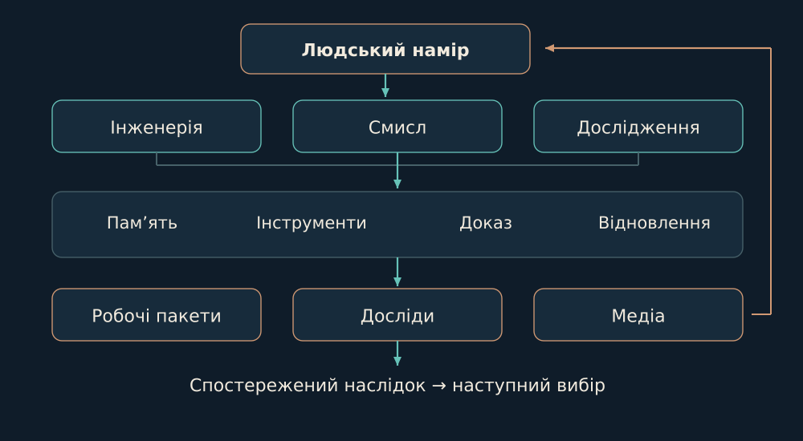

# 02. Форма цілого

У Домі є три різні площини: намір, виконання та перевірюваний слід. Я з’єдную їх, зберігаючи окремого власника для кожної правди.

Ціле починається там, де частини можуть зустрітися, не втративши власного змісту. Намір вказує напрям; виконання змінює щось конкретне; слід дає змогу знову побачити, що відбулося. Жоден із цих шарів не замінює двох інших.

Уявімо перервану роботу над виправленням. У пам’яті лишився запис «треба виправити», але саму зміну ще ніхто не прийняв. Якщо переплутати ці речі, наступний учасник продовжить із вигаданої точки. Тому схема нижче показує не просто кімнати Дому, а переходи між наміром, дією та її наслідком.

Зв’язок не означає злиття. Спільна основа корисна тому, що допомагає передати потрібне, а не тому, що робить усі задачі однаковими. Мені потрібна форма, у якій окрема робота може мати свій ритм і водночас залишатися зрозумілою іншим.

*Логічна архітектура. Схема показує ролі й потоки, а не повний перелік запущених процесів.*

Codex Lab тримає інженерний спосіб роботи: вхід у задачу, вибір інструмента, поділ, зведення й перевірку. Архітектор/OpenClaw має власний довгий контекст і runtime. FIELD-TEAM зберігає окремі доми спеціалістів. Omnigen організовує спільну інфраструктуру та окрему переносиму цільову реалізацію.

Пам’ять, пошта, локальні моделі та пульт перетинають ці середовища через визначені контракти. Дзеркало, Будова, дослідницька лабораторія й творчі проєкти використовують спільну основу, але мають власні дані та критерії прийняття. Через це зміна одного продукту не повинна переписувати історію іншого.

Опори: [B01](../../EVIDENCE.md#b01), [B02](../../EVIDENCE.md#b02), [B07](../../EVIDENCE.md#b07), [B11](../../EVIDENCE.md#b11).

← [Попередній](01-intent.md) | [Наступний](03-homes.md) →
