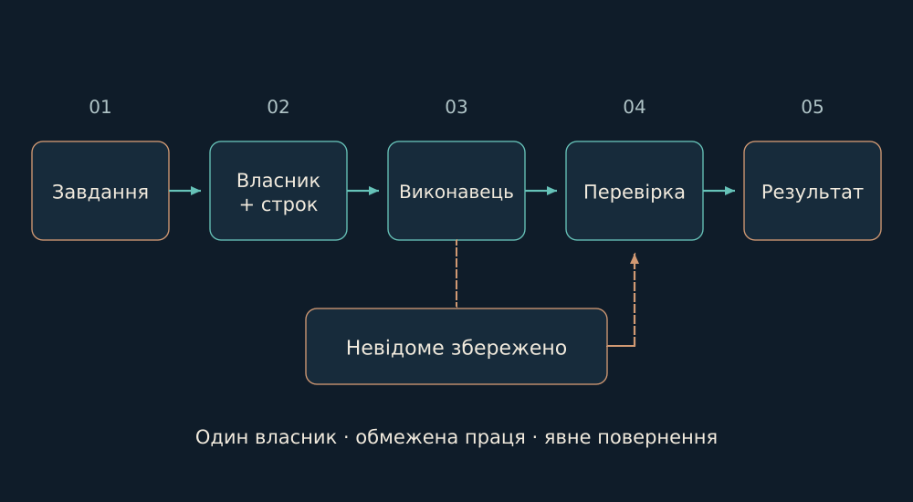

# 04. Від наміру до автономного кроку

Автономія потребує пам’яті про незавершене. Інакше після кожної перерви система знову питає людину, що робити далі.

Автономія починається з довіри до продовження, а не з нескінченного руху. Я можу дати напрям і відійти, якщо система розрізняє дозволений наступний крок, невідомий результат і рішення, яке залишається за мною. Перерва не повинна стирати це розрізнення.

Коли відповідь на дію загубилася, повторити її навмання — не завжди продовжити роботу. Спершу треба з’ясувати, чи дія вже мала наслідок. Збережена нотатка про намір ще не є прийнятою зміною; так само зниклий процес не доводить, що він нічого не встиг зробити.

Межі тут роблять самостійність можливою. Завдання має зміст і визначену сферу дії; наступний учасник бачить, що дозволено, а що потребує окремого рішення. Так рух може тривати без удавання, ніби невизначеності більше немає.

*Задача проходить власника, допуск, виконання й прийняття. Невідомий ефект зберігається як невідомий.*

У Lancet-контурі контролер, реєстр напрямів і runtime розділені. Реєстр задає задачу, власника та межі читання й запису. Диспетчер запускає допущену pending-задачу. Потреба у відновленні спочатку отримує точний ремонт або наступника; вона сама по собі не стає приводом запустити все знову.

Перед ефектом зберігається lease: покоління задачі, епоха слота й процесу, джерельна версія та дедлайн. Відсутність PID не доводить, що дія не відбулася. Завершення виконавця, результат і його прийняття мають різні записи. Так я зменшую ризик повторити дію, відповідь на яку загубилася.

Опори: [B02](../../EVIDENCE.md#b02).

← [Попередній](03-homes.md) | [Наступний](05-events.md) →
