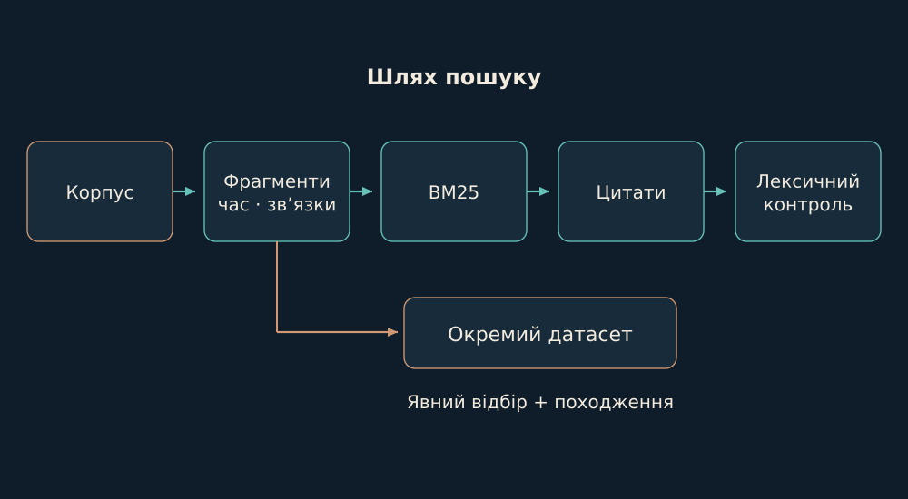

# 07. Поле: пошук, який повертає підставу

У Поля є власний стек пам’яті. Його важливо бачити як послідовність конкретних перетворень, а не як загальне слово «RAG».

*Походження → фрагмент → час і зв’язки → пошук → цитата → лексична перевірка.*

Сканер фіксує джерела; фрагментатор додає координати й hash батьківського файла; часовий шар відділяє порядок запису від авторства. Граф містить явні посилання. BM25-пошук нормалізує цифри та кириличні префікси й ранжує фрагменти за частотою терміна, його рідкістю та довжиною документа.

$$
\operatorname{score}(q,d)=\sum_{t\in q}\operatorname{IDF}(t)\frac{f(t,d)(k_1+1)}{f(t,d)+k_1(1-b+b|d|/\overline{|d|})}
$$

Розширення пошуку додає сусідів за графом. Gate зіставляє слова речень із цитованими фрагментами, покриття запиту й узгодженість цитат із пошуком; зберігає перший провал. Це лексичний контроль. Він допомагає помічати непідкріплені відповіді, але не є доказом логічного випливання. Так само збережений hash індексу потребує звірки зі свіжими байтами перед важливою дією.

Опори: [B04](../../EVIDENCE.md#b04).

← [Попередній](06-memory.md) | [Наступний](08-data.md) →
