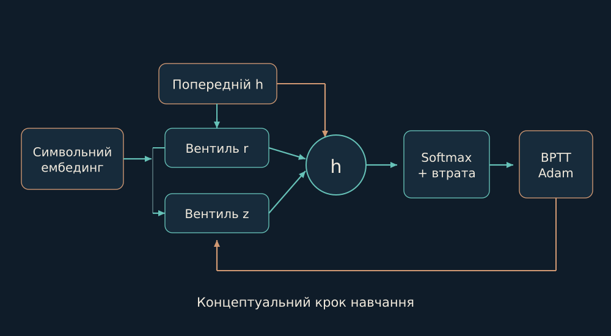

# 09. Власна нейромережева майстерня

У цьому напрямі вже є навчання, ваги й власна реалізація нейромережі. Це окремий технічний шар, який легко пропустити, читаючи лише старі описи корпусу.

Мені хочеться бачити навчання зсередини, на масштабі, де ще можна простежити кожне перетворення. Невелика символьна мережа дає таку можливість: вона отримує попередні символи й намагається передбачити наступний, поступово змінюючи ваги.

Прихований стан не є повним записом прочитаного. Це обмежене представлення, яке переноситься між кроками; ворота визначають, як у ньому поєднуються попередній стан і новий кандидат. Наприклад, після початку слова мережа може використати цей стан для розподілу наступного символу.

Це майстерня для дослідження механізму, а не короткий шлях до твердження про загальне розуміння. Її розміри, формула і спосіб оновлення важливі саме тому, що дозволяють поставити конкретне питання про конкретну реалізацію.

*Концептуальний forward GRU. Зворотний прохід і перевірка похідних - окрема частина реалізації.*

Такий масштаб має власну цінність: я можу співвіднести те, що формула обіцяє, з тим, що насправді робить код. Якщо вони розходяться, треба дослідити цю розбіжність, а не переносити висновок із назви архітектури на будь-яку її реалізацію.

Символьна GRU написана на NumPy. Символ переходить у embedding розміру 64; прихований стан має 192 координати. Reset і update gates керують тим, як попередній стан входить у candidate і як змішується з ним. Лінійна проєкція та softmax дають розподіл наступного символу.

$$
h_t=(1-z_t)\odot h_{t-1}+z_t\odot\widetilde h_t
$$

Реалізація містить ручний backward-through-time, накопичення градієнтів embedding, Adam з корекцією моментів та обмеження норми градієнта. Базовий checkpoint має 315 339 параметрів; оглянуті варіанти з іншим словником - 326 904. Це мала навчувана мовна модель на рівні символів, а не готова велика розмовна LLM.

Опори: [B06](../../EVIDENCE.md#b06).

← [Попередній](08-data.md) | [Наступний](10-experiment.md) →
