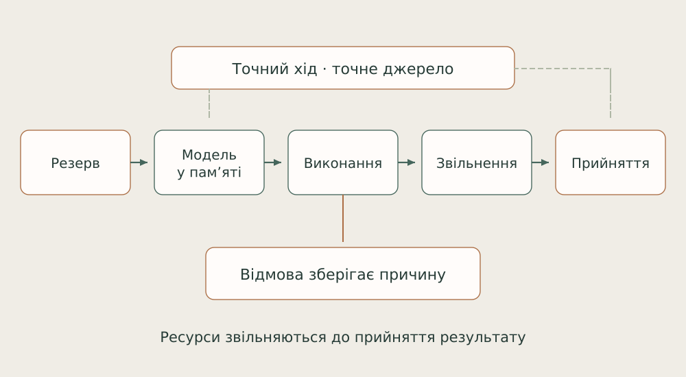

# 11. Модельний шар і ресурси

Основна модель агента й локальний спеціаліст виконують різну роботу. Я з’єдную їх через контрольований інструментальний шар.

Один співробітник не мусить виконувати кожне перетворення сам. Пошук подібного фрагмента, переупорядкування результатів і аналіз коду можуть бути окремими інструментами. Їх варто з’єднувати так, щоб результат повертався саме до того питання, для якого його замовили.

Наприклад, пошук може завершитися після того, як задача вже змінилася. Відповідь може бути технічно правильною для старого запиту й водночас непридатною для нового. Тому контекст виклику — частина значення відповіді, а не лише службова подробиця.

Спільні ресурси теж потребують узгодження: два запити не повинні мовчки заважати один одному, а завершення роботи має залишати чистий стан. Я оцінюю цей шар за тим, чи допомагає він виконати певну задачу, а не за кількістю доступних моделей.

*Успіх включає завершення дочірнього процесу й звільнення ресурсу. Відповідь також має належати чинному запиту.*

Stage4 поєднує Nomic embeddings, Qwen3-Reranker 0.6B та LateOn-Code CPU. Один worker координує ресурсний lease, взаємне виключення, свіжі спостереження місткості й покоління налаштувань. Code lookup виконується у тимчасовому дочірньому процесі; батько приймає результат після перевірки порядку, cleanup і reap.

Native plugin додатково звіряє agent/session/turn/step. Коректна відповідь для вже іншого кроку має бути відхилена. Відкат налаштувань створює нове покоління, а не повертає старий номер. Так provenance і керування ресурсом входять у визначення правильного результату.

Збережений readback семи маршрутів показує фактичні виклики цього шару. Межі навантаження й негативні CPU-випадки залишаються в оцінюванні. Кількість моделей я не використовую як заміну якості маршруту.

Опори: [B07](../../EVIDENCE.md#b07).

← [Попередній](10-experiment.md) | [Наступний](12-sufficiency.md) →
