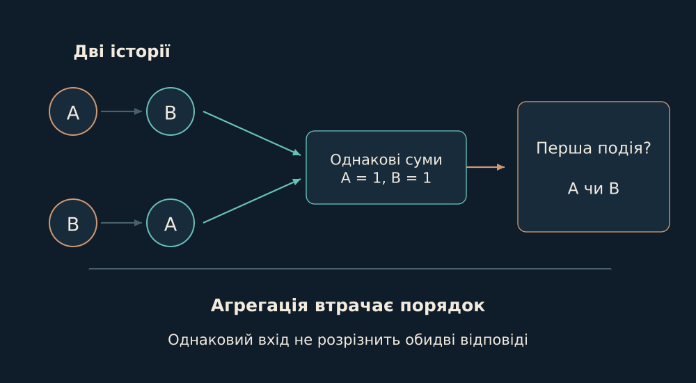

# 12. Математика достатнього стану

Одне з центральних питань Дому: яку частину історії треба зберегти, щоб наступне рішення взагалі було можливим?

Стиснення необхідне: ніхто не може щоразу передавати всю історію. Але кожне стискання щось відкидає. Перш ніж просити систему відповісти, я хочу знати, чи залишилася в її представленні інформація, від якої залежить правильна відповідь.

Уявімо два потоки з однаковими загальними лічильниками, але з іншим порядком подій. Якщо наступне рішення залежить від того, що сталося раніше, однакових підсумків недостатньо. Стиснення загубило саме ту відмінність, за якою доведеться обрати дію. Питання достатності починається з рішення, яке ми хочемо зберегти.

Формула нижче висловлює цю умову точно: ціль має бути сталою на кожній множині історій, що стискаються до одного представлення. Вона не каже, як саме знайти добре представлення; вона дозволяє відкинути таке, що вже стерло потрібну різницю.

*Дві історії мають однакові лічильники, але різний порядок. Самі лічильники не відновлять, що сталося першим.*

Нехай P стискає історію x до представлення, а T(x) - потрібна відповідь. Точне відновлення через це представлення можливе лише тоді, коли будь-які історії з однаковим P мають однаковий T. Інакше один і той самий вхід вимагає двох різних відповідей. Жодна впевненість моделі не поверне інформацію, яку стерло представлення.

$$
T=g\circ P\quad\Longleftrightarrow\quad P(x)=P(y)\Rightarrow T(x)=T(y)
$$

Я застосовую це як інструмент проєктування пам’яті й оцінювання. У скінченному CreditWorld reference з історією розрізнив 16 із 16 development-випадків; для memoryless-проєкції межа становила 8 із 16. Прибраний feedback і неправильний зв’язок перевірялися окремо. Це контрольована демонстрація достатності стану, не вимір навченої LLM.

Опори: [B08](../../EVIDENCE.md#b08).

← [Попередній](11-model-plane.md) | [Наступний](13-order.md) →
