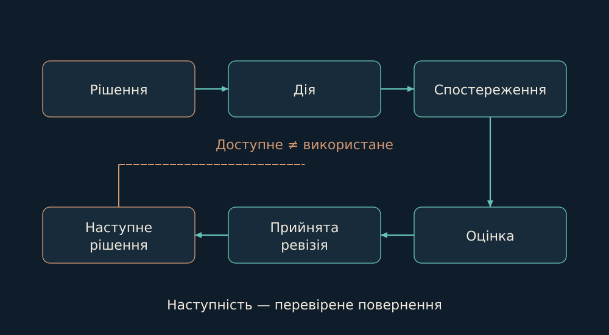

# 15. Перегляд судження й continuity

Мені важливо бачити, що саме змінилося після досвіду. Запис уроку - лише один із можливих слідів.

*Return path пов’язує наслідок із прийнятим переглядом і пізнішим рішенням. Це критерій записів.*

У AI Ontology я розводжу доступний доказ і фактично використаний запис; прийняття критерію і його виконання; збережений lesson і formation; зафіксований effect і завершений return path. Ці розрізнення потрібні, щоб у слові «навчився» не загубився конкретний процес.

Публічний reference має скінченну модель записів, відношення, competency queries, проєкції та JSON/JSONL audit. Версія книги 3.7.0 поєднує концептуальні розділи, виконуваний шар, досліди та ledger тверджень. Запропонований audit profile має явні межі; я не називаю його прийнятим індустріальним стандартом.

Окремий prospective evaluator фіксує тезу, контртезу, горизонт і умову спростування до наслідку. Вікно випадків лишається фіксованим: ранню незавершену спробу не можна замінити пізнішим успіхом. Це реалізований механізм prospective-оцінювання; його природний повний цикл і користь у наступних задачах оцінюються окремо.

Опори: [B10](../../EVIDENCE.md#b10), [B11](../../EVIDENCE.md#b11).

← [Попередній](14-shadow.md) | [Наступний](16-runtime.md) →
