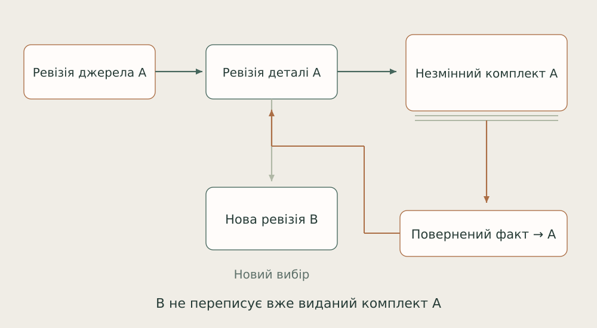

# 18. Будова: точна ревізія реальної роботи

Мій предметний досвід задає адресата продукту: виконроб або бригадир має зрозуміти, що саме йому передали і на якій підставі.

*Виданий комплект і повернутий факт залишаються при своїй ревізії, навіть коли поточний head уже інший.*

Джерело, геометрія деталі й переданий комплект мають окремі незмінні прив’язки. Модель містить точні контури й отвори, одиниці, DXF/map та оригінальні CAD-джерела. Новий обмір не переписує вже виданий пакет.

Збереження проєкту виконує транзакційний CAS. Точний request replay перевіряється до ревізійного конфлікту. Фоновий export проходить staging, recovery record, fsync і rename. Історичний факт проходить preview і CAS та додається до своєї ревізії. Старий cumulative прогрес не має перетворитися на новий додаток лише через повтор запиту.

Локальні UI/HTTP сценарії вже видали комплект із 18 елементами й двома CAD-оригіналами та повернули той самий frozen ZIP після контрольованої втрати live-джерела. Професійний користувацький прохід і останнє served-origin приймання монтажного читача лишаються наступними межами саме цього продукту.

Опори: [B13](../../EVIDENCE.md#b13).

← [Попередній](17-mirror.md) | [Наступний](19-science.md) →
