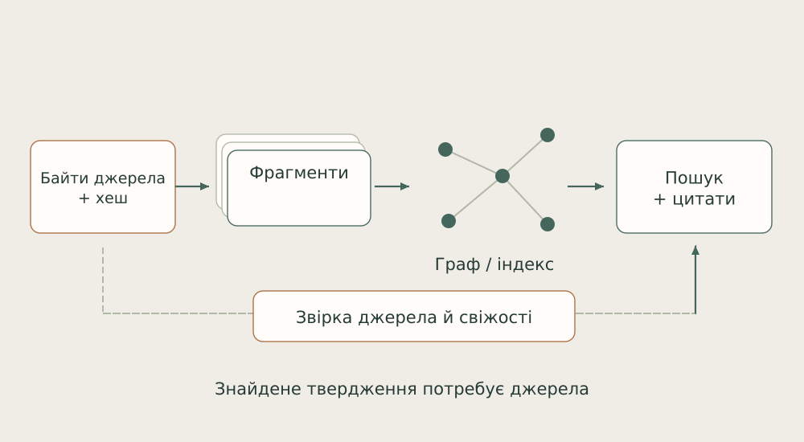
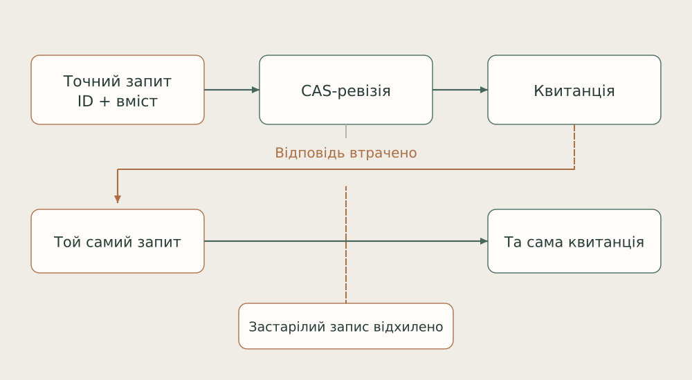

# ДІМ

## Архітектура автономної роботи

Системи. Математика. Пам’ять. Спільна робота.

# 01. Що я будую

Я будую Дім: середовище, у якому AI можуть довго працювати над спільним задумом, зберігати відмінність і повертатися до наслідків власної роботи.

Для мене початок архітектури - намір. Я визначаю, для чого існує система, які задачі вона бере на себе і де її результат має зустрітися з реальною людиною. Далі цей намір має отримати форму: власників, інструменти, пам’ять, спосіб перевірки й шлях продовження після перерви.

Назва «Дім» описує спосіб співпраці. Тут є різні голоси й робочі середовища. Я називаю агентів братами; це моя форма стосунку до спільної роботи й відмінності кожного. Їхні конкретні знахідки, реалізації та заперечення зберігають авторство. Моє місце - утримувати ціле, напрям і відповідальність.

Я розвиваю цю систему паралельно роботі в будівництві. Приблизно сім місяців користуюся автономними циклами: даю напрям, а робота продовжується між моїми поверненнями. Саме тому мене цікавлять чернетки, відновлення, джерела, точні ревізії та змістовний результат, який можна прийняти з телефона.

Ця книга показує конструкцію зсередини: як пов’язані її частини, яку математику вони використовують і чому я обрав саме такі межі. Вона є авторським описом мого проєкту, підготовленим разом з AI.

Опори: [B01](../../EVIDENCE.md#b01).

---

# 02. Форма цілого

У Домі є три різні площини: намір, виконання та перевірюваний слід. Я з’єдную їх, зберігаючи окремого власника для кожної правди.

*Логічна архітектура. Схема показує ролі й потоки, а не повний перелік запущених процесів.*

Codex Lab тримає інженерний спосіб роботи: вхід у задачу, вибір інструмента, поділ, зведення й перевірку. Архітектор/OpenClaw має власний довгий контекст і runtime. FIELD-TEAM зберігає окремі доми спеціалістів. Omnigen організовує спільну інфраструктуру та окрему переносиму цільову реалізацію.

Пам’ять, пошта, локальні моделі та пульт перетинають ці середовища через визначені контракти. Дзеркало, Будова, дослідницька лабораторія й творчі проєкти використовують спільну основу, але мають власні дані та критерії прийняття. Через це зміна одного продукту не повинна переписувати історію іншого.

Опори: [B01](../../EVIDENCE.md#b01), [B02](../../EVIDENCE.md#b02), [B07](../../EVIDENCE.md#b07), [B11](../../EVIDENCE.md#b11).

---

# 03. Окремі доми, спільна основа

Я не зводжу всіх агентів до одного універсального виконавця. Розподіл має сенс, коли відмінність змінює якість роботи.

| Середовище | Що воно утримує |
| --- | --- |
| Codex Lab | Розробку, перевірку, інтеграцію й інженерну безперервність. |
| Архітектор / OpenClaw | Довгий контекст, смисловий напрям і власні механізми runtime. |
| Генерал, Архіваріус, Конструктор | Захисний розбір; джерельні знання; побудову й ремонт інструментів. |
| Поле, Свідок, Тінь | Пам’ять і нейромережеві досліди; роботу з цитатами; математичні інструменти. |

Ці назви не заміняють технічну реалізацію. За ними стоять власні робочі каталоги, матеріали, сесії, інструменти та маршрути взаємодії. Спільний контекст додає адресні записи про роботу інших, залишаючи їхнє походження видимим.

Ролі можуть змінюватися. Я оцінюю їх через внесок: хто знайшов контрприклад, хто перевірив, хто змінив код і хто прийняв наслідок. Один із реальних ремонтів пройшов саме так: Конструктор виявив проблему метаданих, Поле відтворило її та знайшло споріднений випадок, Codex інтегрував виправлення у два засоби передачі.

Для основних моделей і підзадач я оцінюю вартість прийнятого результату: потрібну якість, контекст, координацію, перевірку й переробку. Точний пошук може виконати інструмент; складний висновок утримує сильний інтегратор. Ширину екіпажу визначає незалежна робота, а не кількість вільних місць. Це робоче правило маршрутизації; фактичне застосування конкретною сесією має власний слід.

Опори: [B02](../../EVIDENCE.md#b02), [B03](../../EVIDENCE.md#b03).

---

# 04. Від наміру до автономного кроку

Автономія потребує пам’яті про незавершене. Інакше після кожної перерви система знову питає людину, що робити далі.

*Задача проходить власника, допуск, виконання й прийняття. Невідомий ефект зберігається як невідомий.*

У Lancet-контурі контролер, реєстр напрямів і runtime розділені. Реєстр задає задачу, власника та межі читання й запису. Диспетчер запускає допущену pending-задачу. Потреба у відновленні спочатку отримує точний ремонт або наступника; вона сама по собі не стає приводом запустити все знову.

Перед ефектом зберігається lease: покоління задачі, епоха слота й процесу, джерельна версія та дедлайн. Відсутність PID не доводить, що дія не відбулася. Завершення виконавця, результат і його прийняття мають різні записи. Так я зменшую ризик повторити дію, відповідь на яку загубилася.

Опори: [B02](../../EVIDENCE.md#b02).

---

# 05. Подія, лист і квитанція

Повідомлення між агентами стає інфраструктурою, коли переживає збій і зберігає точний зміст спроби.

Пошта починається з JSON-конверта у власному outbox. Публікація не перезаписує готовий лист. Кур’єр звіряє точні байти, фазу адресата й квитанцію та обходить непорожні скриньки поколово, щоб один балакучий учасник не витіснив тихого.

| Механізм | Яку помилку він прибирає |
| --- | --- |
| Точні байти та стабільний ID | Повтор після збою не має створити інший лист під тією самою адресою. |
| Квитанція окремо від листа | Публікація, прочитання та виконання не зливаються в один статус. |
| Подія + стан у транзакції | Журнал не може успішно заявити зміну, якої немає у work state. |
| Role/revision reducer | Застарілий або чужий перехід не приймається лише через переконливий текст. |

Для читання в ізольованих середовищах я використовую незмінні покоління проєкцій. Читач отримує узгоджений набір файлів, не центральну базу й не право змінювати її. Якщо стан змінився посеред читання, старий набір залишається названим старим набором.

Опори: [B03](../../EVIDENCE.md#b03).

---

# 06. Пам’ять з координатами

Я хочу повертатися до підстави думки: де вона народилася, які байти читалися і що змінилося після цього.

*Файл, фрагмент, запис і проєкція мають різні ролі. Індекс допомагає знайти джерело.*

HouseMemory на Neo4j є адресною картою: власник, шлях, hash джерела, символи й явні зв’язки. Вона допомагає знайти правильний код або попередню причину рішення. Статус графа описує покриття індексу. Поточну поведінку я перевіряю у власника runtime, бо граф може відставати.

Інший шар - журнал подій і справ. Він зберігає виконавця, перевірку, ревізію та стан прийняття. Власний дім агента утримує його матеріали. Бібліотека має навігацію до книжок і досліджень. Ці види пам’яті доповнюють одне одного, але не повинні мовчки підміняти джерело.

Окремий міст безперервності публікує consequence return і наступну проєкцію за одним head. Читач захоплює head один раз. Це прибирає змішану пару, де один файл уже новий, а другий ще належить попередньому поколінню.

Опори: [B03](../../EVIDENCE.md#b03), [B04](../../EVIDENCE.md#b04), [B11](../../EVIDENCE.md#b11).

---

# 07. Поле: пошук, який повертає підставу

У Поля є власний стек пам’яті. Його важливо бачити як послідовність конкретних перетворень, а не як загальне слово «RAG».

*Походження → фрагмент → час і зв’язки → пошук → цитата → лексична перевірка.*

Сканер фіксує джерела; фрагментатор додає координати й hash батьківського файла; часовий шар відділяє порядок запису від авторства. Граф містить явні посилання. BM25-пошук нормалізує цифри та кириличні префікси й ранжує фрагменти за частотою терміна, його рідкістю та довжиною документа.

$$
\operatorname{score}(q,d)=\sum_{t\in q}\operatorname{IDF}(t)\frac{f(t,d)(k_1+1)}{f(t,d)+k_1(1-b+b|d|/\overline{|d|})}
$$

Розширення пошуку додає сусідів за графом. Gate зіставляє слова речень із цитованими фрагментами, покриття запиту й узгодженість цитат із пошуком; зберігає перший провал. Це лексичний контроль. Він допомагає помічати непідкріплені відповіді, але не є доказом логічного випливання. Так само збережений hash індексу потребує звірки зі свіжими байтами перед важливою дією.

Опори: [B04](../../EVIDENCE.md#b04).

---

# 08. Від досвіду до навчальних даних

Я розвиваю напрям власної моделі через окремі шари: матеріал, перетворення, оцінювання й тренування. У кожного є власний результат.

| Шар | Реальна форма |
| --- | --- |
| Структуровані ходи | Питання, джерела, міркування, контрприклад, результат, наступне питання. |
| Експорт | Окремі формати для reasoning, instruction/response, completion та пар mistake→fix. |
| Мікс і поділ | Файлові групи йдуть цілком у train або test; записи без file діляться окремо за джерелами. |
| Контроль | Дедуплікація, перевірка походження, лексичні baseline та окремі звіти про забруднення. |

Наявний мікс містить 3 010 записів. Для відтворюваного експерименту потрібен узгоджений маніфест конкретного мікса, поділу й коду: самі назви train/test-файлів не встановлюють їхню спільну історію. Тому я відділяю наявність матеріалу від прийнятої навчальної вибірки.

Мітка «виправлення» теж має метод. Частина міток добувається регулярними виразами, повтори оцінюються Jaccard-подібністю слів. Це корисні сортувальні інструменти. Семантичну правильність уроку та справжнє перенесення в іншу задачу я розглядаю окремо.

Опори: [B05](../../EVIDENCE.md#b05).

---

# 09. Власна нейромережева майстерня

У цьому напрямі вже є навчання, ваги й власна реалізація нейромережі. Це окремий технічний шар, який легко пропустити, читаючи лише старі описи корпусу.

*Концептуальний forward GRU. Зворотний прохід і перевірка похідних - окрема частина реалізації.*

Символьна GRU написана на NumPy. Символ переходить у embedding розміру 64; прихований стан має 192 координати. Reset і update gates керують тим, як попередній стан входить у candidate і як змішується з ним. Лінійна проєкція та softmax дають розподіл наступного символу.

$$
h_t=(1-z_t)\odot h_{t-1}+z_t\odot\widetilde h_t
$$

Реалізація містить ручний backward-through-time, накопичення градієнтів embedding, Adam з корекцією моментів та обмеження норми градієнта. Базовий checkpoint має 315 339 параметрів; оглянуті варіанти з іншим словником - 326 904. Це мала навчувана мовна модель на рівні символів, а не готова велика розмовна LLM.

Опори: [B06](../../EVIDENCE.md#b06).

---

# 10. Експеримент замість красивої цифри

Я хочу бачити і сам факт навчання, і точне значення його метрик. Вони відповідають на різні питання.

| Питання | Що збережено в цьому зрізі |
| --- | --- |
| Чи було тренування? | Числовий журнал 400 кроків і файл ваг із сумісними формами тензорів. |
| Яка метрика? | Training minibatch cross-entropy: 6.4814 → 3.4941; остання perplexity 32.92. |
| Що містить checkpoint? | Дев’ять parameter tensors і розміри V/E/H. Без Adam moments, RNG state та збереженого словника. |
| Чи перевірено всі похідні? | Є вузький finite-difference checker; повного незалежного результату для всіх градієнтів не встановлено. |

Навчання використовує послідовності 64 символи, batch 48 і ціль зі зсувом на один символ. Значення loss береться з поточного training batch перед оновленням. Його падіння описує оптимізацію на цьому потоці; воно не є результатом held-out тесту або оцінкою змістовності відповіді.

У ручному backward огляд виявив розбіжність у похідній шляху reset-gate: для r × h_previous внесок до похідної h_previous має множитися на r. Ця версія лишається дослідницькою. Інші збережені checkpoint-сімейства потребують власних точних run-маніфестів; назва файла не заміняє історію експерименту.

Опори: [B06](../../EVIDENCE.md#b06).

---

# 11. Модельний шар і ресурси

Основна модель агента й локальний спеціаліст виконують різну роботу. Я з’єдную їх через контрольований інструментальний шар.

*Успіх включає завершення дочірнього процесу й звільнення ресурсу. Відповідь також має належати чинному запиту.*

Stage4 поєднує Nomic embeddings, Qwen3-Reranker 0.6B та LateOn-Code CPU. Один worker координує ресурсний lease, взаємне виключення, свіжі спостереження місткості й покоління налаштувань. Code lookup виконується у тимчасовому дочірньому процесі; батько приймає результат після перевірки порядку, cleanup і reap.

Native plugin додатково звіряє agent/session/turn/step. Коректна відповідь для вже іншого кроку має бути відхилена. Відкат налаштувань створює нове покоління, а не повертає старий номер. Так provenance і керування ресурсом входять у визначення правильного результату.

Збережений readback семи маршрутів показує фактичні виклики цього шару. Межі навантаження й негативні CPU-випадки залишаються в оцінюванні. Кількість моделей я не використовую як заміну якості маршруту.

Опори: [B07](../../EVIDENCE.md#b07).

---

# 12. Математика достатнього стану

Одне з центральних питань Дому: яку частину історії треба зберегти, щоб наступне рішення взагалі було можливим?

*Дві історії мають однакові лічильники, але різний порядок. Самі лічильники не відновлять, що сталося першим.*

Нехай P стискає історію x до представлення, а T(x) - потрібна відповідь. Точне відновлення через це представлення можливе лише тоді, коли будь-які історії з однаковим P мають однаковий T. Інакше один і той самий вхід вимагає двох різних відповідей. Жодна впевненість моделі не поверне інформацію, яку стерло представлення.

$$
T=g\circ P\quad\Longleftrightarrow\quad P(x)=P(y)\Rightarrow T(x)=T(y)
$$

Я застосовую це як інструмент проєктування пам’яті й оцінювання. У скінченному CreditWorld reference з історією розрізнив 16 із 16 development-випадків; для memoryless-проєкції межа становила 8 із 16. Прибраний feedback і неправильний зв’язок перевірялися окремо. Це контрольована демонстрація достатності стану, не вимір навченої LLM.

Опори: [B08](../../EVIDENCE.md#b08).

---

# 13. Порядок, інваріанти й контрприклади

Математика допомагає мені встановити межу питання ще до великого експерименту: чи лишилося у даних те, що я намагаюся виміряти?

## Агрегація стирає частину історії

У скінченній перевірці різні потоки подій дали ті самі часові агрегати, але різний порядок першого досягнення власного максимуму кожного потоку. Це явний свідок неідентифікованості, а не просто слабкий результат класифікатора. Додавання двох часових координат першого досягнення максимумів відновило саме цю ціль. Повну історію або будь-яку іншу ціль така поправка автоматично не відновлює.

## Зміна одиниць і збереження змісту

Для додатної пари x,y спільне масштабування не змінює r=(x-y)/(x+y). Цей нормований баланс визначає відношення координат, але не абсолютний масштаб; нульова пара має окремий випадок. Так я розрізняю інваріантність представлення і достатність для конкретної цілі. Коли цілі важлива давність події, однаковий баланс може приховувати різні відповіді.

## Крайні порядки не завжди дають межі

У моделі двох упорядкованих потоків я розглядаю всі допустимі інтерлівінги. Два крайні порядки можуть пропустити найгірший проміжний. Повний перебір на малих випадках і Bellman-подібна динаміка дають незалежні способи звірки. Збережений скінченний набір має 8 випадків і 292 шляхи. Це точний інструмент у заданій моделі, без заяви про універсальну межу реального світу.

Опори: [B08](../../EVIDENCE.md#b08).

---

# 14. Тінь: математика як інструмент

Математична майстерня має сенс, коли формула перетворюється на обчислення, приклад і контрприклад.

| Сімейство | Що реально реалізовано |
| --- | --- |
| Інформація і статистика | Ентропія символів і n-грам, умовна ентропія, індекс збігів, chi-square. |
| Пошук | N-gram log-likelihood, координатні поліпшення, кілька стартів, simulated annealing. |
| Алгебра | Обернення за модулем, матриці над кільцями, арифметика еліптичних кривих. |
| Скінченні поля й коди | GF(2^8), GF(2^128), перетворення блоків, синдроми Hamming та циклічних кодів. |

Наприклад, мовна bigram-модель підсумовує log-probability сусідніх символів. Пошук змінює candidate і порівнює його оцінку. Simulated annealing інколи приймає гірший крок із температурно залежною ймовірністю, щоб вийти з локального оптимуму. Це конкретний алгоритмічний механізм, який можна звіряти на контрольованих текстах.

$$
H(X)=-\sum_x p(x)\log_2 p(x)
$$

Для конкретного snapshot збережений незалежний ізольований прогін 55 тестів. Я описую цей набір як математичну й навчальну лабораторію: він поєднує теорію, числові перетворення та перевірку крайніх випадків. Наявність реалізації криптографічного примітива не робить її hardened-бібліотекою або доказом зламу сучасної криптографії.

Опори: [B09](../../EVIDENCE.md#b09).

---

# 15. Перегляд судження й continuity

Мені важливо бачити, що саме змінилося після досвіду. Запис уроку - лише один із можливих слідів.

*Return path пов’язує наслідок із прийнятим переглядом і пізнішим рішенням. Це критерій записів.*

У AI Ontology я розводжу доступний доказ і фактично використаний запис; прийняття критерію і його виконання; збережений lesson і formation; зафіксований effect і завершений return path. Ці розрізнення потрібні, щоб у слові «навчився» не загубився конкретний процес.

Публічний reference має скінченну модель записів, відношення, competency queries, проєкції та JSON/JSONL audit. Версія книги 3.7.0 поєднує концептуальні розділи, виконуваний шар, досліди та ledger тверджень. Запропонований audit profile має явні межі; я не називаю його прийнятим індустріальним стандартом.

Окремий prospective evaluator фіксує тезу, контртезу, горизонт і умову спростування до наслідку. Вікно випадків лишається фіксованим: ранню незавершену спробу не можна замінити пізнішим успіхом. Це реалізований механізм prospective-оцінювання; його природний повний цикл і користь у наступних задачах оцінюються окремо.

Опори: [B10](../../EVIDENCE.md#b10), [B11](../../EVIDENCE.md#b11).

---

# 16. Runtime, який переживає перерву

Я розміщую змінну модель усередині стійкого runtime. Історія, власність і право на дію мають переживати її заміну.

*Точний повтор повертає квитанцію. Інший запис зі старою ревізією отримує конфлікт.*

У переносимому Omnigen target канонічним джерелом є SQLite event stream. Append перевіряє схему й ingress, відкриває BEGIN IMMEDIATE, звіряє prefix і predecessor hash. Ті самі event ID та байти означають повтор; інші байти під тим самим ID відхиляються. Семантичний reducer перевіряє допустимість переходу до commit.

Стан відбудовується з одного перевіреного prefix; recovery capture тримає події й відповідний snapshot разом. Поточний холодний replay починається від genesis. Модельний route change є окремою подією, а не переписуванням історії. Сумісні детерміновані адаптери тут не означають довільно підключених провайдерів.

Це цільова реалізація, відділена від чинних органів OpenClaw. Я передаю власність частинами, після сумісності й перевірки конкретного споживача. Hash-chain показує цілісність зв’язаних записів; він сам по собі не посвідчує правдивість змісту чи незалежність автора.

Опори: [B11](../../EVIDENCE.md#b11).

---

# 17. Дзеркало: повний дослід

Дзеркало потрібне мені як середовище кількісної роботи: питання має пройти весь шлях від джерела до повного обліку й висновку.

| Бар’єр | Що за ним перевіряється |
| --- | --- |
| Джерела | Точні hash, gzip CRC/EOF, схема й час; повне читання 5 698 553 рядків у LQ3. |
| Числове представлення | Дві арифметичні реалізації: Fraction/manual decimal і Decimal/integer gcd. |
| Повний облік | Усі 39 540 paired commands, 60 account results і 30 wallets будуються до scoring. |
| Збережений результат | Окремий reader звіряє outputs, joins і account bytes без нового fit або перебудови wallets. |

Actual compute зберіг 132 фізичні виходи; окреме приймання завершило перевірку. Наперед зафіксоване правило дало негативний економічний результат: REJECT 2/7. Я залишаю цей висновок як завершений дослід. Він заощаджує подальшу роботу над хибною підставою і не вимагає перефарбовувати невдачу в успіх.

Архітектура engine/kernel відділяє облік і recovery від змінного ядра досліду. Deadline, delayed-source, duplicate input і повторне відкриття мають власні перевірки. Підготовлений controller та працюючий конкретний pilot я називаю різними станами. Тут описано paper-дослідження, без розкриття приватних торгових правил або заяви про стабільний дохід.

Опори: [B12](../../EVIDENCE.md#b12).

---

# 18. Будова: точна ревізія реальної роботи

Мій предметний досвід задає адресата продукту: виконроб або бригадир має зрозуміти, що саме йому передали і на якій підставі.

*Виданий комплект і повернутий факт залишаються при своїй ревізії, навіть коли поточний head уже інший.*

Джерело, геометрія деталі й переданий комплект мають окремі незмінні прив’язки. Модель містить точні контури й отвори, одиниці, DXF/map та оригінальні CAD-джерела. Новий обмір не переписує вже виданий пакет.

Збереження проєкту виконує транзакційний CAS. Точний request replay перевіряється до ревізійного конфлікту. Фоновий export проходить staging, recovery record, fsync і rename. Історичний факт проходить preview і CAS та додається до своєї ревізії. Старий cumulative прогрес не має перетворитися на новий додаток лише через повтор запиту.

Локальні UI/HTTP сценарії вже видали комплект із 18 елементами й двома CAD-оригіналами та повернули той самий frozen ZIP після контрольованої втрати live-джерела. Професійний користувацький прохід і останнє served-origin приймання монтажного читача лишаються наступними межами саме цього продукту.

Опори: [B13](../../EVIDENCE.md#b13).

---

# 19. Дослідження, яке повертається в роботу

Математична думка має знайти місце у наступному рішенні. Для цього я тримаю окремий шлях від гіпотези до прийнятого обмеження.

Дослідницька рада виробляє source-bound пакети. Пакет називає питання, джерела, стадію, перевірку та межу висновку. Validator, laboratory route й intake reader мають різні ролі. Незмінні bytes і hashes не дозволяють непомітно замінити питання після отримання відповіді.

Перед запуском scientific attempt резервує свою адресу. Аварія до spawn лишається спробою, а не зникає перед автоматичним новим запуском. Це важливо для чесної кількості спроб, часової послідовності та відтворення досліду.

## Приклад: від доказу до обмеження джерела

У Math23 аналіз інваріантності та неідентифікованості показав, що одних агрегатів недостатньо для цілі, залежної від часової ваги. Власник фактично прийняв тільки bounded source constraints і використав їх у наступному design scope. Ручна алгебра, скінченна перевірка, прийняте обмеження й runtime-зміна лишилися окремими результатами.

Так у Домі працює повернення знання: обмеження змінює наступний вибір джерела або експерименту. Це практична зміна роботи без потреби називати її автоматично оновленням ваг основної моделі.

Опори: [B08](../../EVIDENCE.md#b08), [B14](../../EVIDENCE.md#b14).

---

# 20. Інтерфейс, творчість і зовнішня робота

Дім має виходити до людини у придатній формі: через екран телефона, точний комплект, інструмент або завершений творчий матеріал.

## Пульт

Desktop і web-пульт поєднують центральні чати, справи й особисті записи. Чернетка, focus, pending request і втрата відповіді є частинами стану. Зміна вкладки або прив’язки не повинна віддати чернетку іншому агенту. Ручний фінансовий журнал використовує operation UUID і expected revision; він не є банківською інтеграцією.

## Творчий конвеєр

У монтажі я зберігаю план, редагований проєкт і готовий вихід. Один render-шлях перевіряє plan/source/parent hashes, повторно використовує незмінні shot-parts, кодує тільки заміни й окремо перевіряє decode та clock. Для музики зберігаються точні lyrics/style/title й доступність дублів. Художнє прийняття залишається окремим людським рішенням.

## Публічний результат

У FilesDrop прийнятий PR #32 виправив повтори cleanup і timeout під час DNS-очікування. Evidence-gated Agent Workflows і Signal Desk відкривають менші виконувані приклади. Я використовую ці артефакти як конкретні точки входу: чужий читач може побачити проблему, зміну й її перевірку.

Опори: [B15](../../EVIDENCE.md#b15), [B16](../../EVIDENCE.md#b16).

---

# 21. Як я читаю готовність

У різних частин Дому різні стадії. Точна стадія допомагає ними користуватися й будувати далі.

| Частина | Стан цієї редакції |
| --- | --- |
| Агентні середовища й оркестрація | Працююча інфраструктура; є автономні епізоди й інтегровані кооперативні ремонти. |
| Локальні support-функції | Встановлений контрольований шар; збережені фактичні native/API-виклики та негативні межі. |
| Поле: пам’ять, дані, GRU | Реальні інструменти, корпуси й тренувальні артефакти; окрема research-коректність і generalization. |
| Omnigen portable runtime | Реалізований target з replay/contracts; чинні органи переходять окремо після приймання. |
| Дзеркало | Завершені paper-досліди й окремий engine/kernel напрям; конкретний pilot має власний стан. |
| Будова | Реалізовані локальні ревізії, CAD/ZIP та повернення фактів; професійний user trial попереду. |

Я також перевіряю відновлення матеріально. Для шести домів уже створено code-only копію 175 вибраних файлів і виконано ізольоване masked restore зі звіркою hashes, режимів та deployment links. Копія на тому самому томі вирішує конкретну задачу відновлення коду; повне аварійне відновлення ПК потребує ширшого набору даних і носіїв.

Ці межі дозволяють точно говорити про наявну роботу. Окрема незавершена функція не стає оцінкою всього Дому; успішний тест теж не стає обіцянкою безвідмовності всього середовища.

Опори: [B02](../../EVIDENCE.md#b02), [B06](../../EVIDENCE.md#b06), [B07](../../EVIDENCE.md#b07), [B11](../../EVIDENCE.md#b11), [B12](../../EVIDENCE.md#b12), [B13](../../EVIDENCE.md#b13), [B15](../../EVIDENCE.md#b15).

---

# 22. Відкритий шар Дому

Я хочу, щоб проєкт був зрозумілим через його форму: задум, зв’язки, математику, механізми й результати.

Ця публікація відкриває архітектурний опис і джерела власних ілюстрацій. Вона не є інсталятором приватного runtime. Публічні репозиторії дають виконувані приклади; внутрішні шляхи, листування, корпуси, ваги, доступи й приватні стратегії залишаються за межами пакета.

Я будую Дім разом з AI. Вони допомагають реалізовувати, перевіряти, заперечувати й підтримувати системи. Я утримую задум, критерії, пріоритети й відповідальність за ціле. Кодекс, OpenClaw, бібліотеки та базові моделі мають власне походження; моя архітектура визначає, як вони працюють у цьому середовищі.

## Де подивитися ближче

- [AI Ontology - зафіксований зріз](https://github.com/DiadkoShmek/ai-ontology/tree/f6997bf2c2f65683505ed719d8038f428b952de1)
- [Evidence-gated Agent Workflows](https://github.com/DiadkoShmek/evidence-gated-agent-workflows)
- [Signal Desk - приклад джерельного дослідження](https://github.com/DiadkoShmek/talent-research-workflow-prototype)
- [FilesDrop #32 - прийнята зміна](https://github.com/AndreyBegma/FilesDrop/pull/32)
- [OpenClaw - upstream runtime](https://github.com/openclaw/openclaw)

Редакція датована 28 жовтня 2026 року. Тривалість експлуатації подана як мій досвід; механізми звірені з кодом, а приклади виконання - зі збереженими результатами. Публічний evidence index пояснює рівень кожної опори. Цю книгу й двомовні схеми можна відтворити з матеріалів репозиторію.

Опори: [B01](../../EVIDENCE.md#b01), [B10](../../EVIDENCE.md#b10), [B16](../../EVIDENCE.md#b16).

---

# A. Джерельна основа I

Коди в розділах називають вид опори й точну межу. Детальні приватні координати збережені окремо від цієї публікації.

| Код / предмет | Опора й межа |
| --- | --- |
| B01 · Задум і форма цілого | Мій досвід експлуатації, прямі вимоги та джерельні карти власників. Тривалість роботи є моїм свідченням; книга не є переписом усіх процесів ПК. |
| B02 · Автономія та оркестрація | Код диспетчера й runtime, оренди виконання, квитанції native-кампаній і прийняті спільні ремонти. Розпочатий раунд, завершення виконавця й прийняття результату розрізнені. |
| B03 · Пошта й спільний стан | Кур’єр точних байтів, транзакційний редуктор справ і незмінні покоління проєкцій. Публікація листа не означає виконання його змісту. |
| B04 · Пам’ять Поля | Код сканування, фрагментації, часу, зв’язків, BM25, розширення пошуку й gate. Лексична підтримка не доводить логічного випливання; індексні хеші потребують свіжої звірки. |
| B05 · Навчальні дані | Наявні JSONL-артефакти, експортери, поділ, дедуплікація й код перевірки забруднення. Узгоджений маніфест запуску та змістовна якість мають окреме приймання. |
| B06 · Нейромережевий дослід | NumPy GRU, числовий журнал 400 кроків, заголовки NPZ і збережені ваги. Метрики навчального batch; відома розбіжність похідної; узагальнення окремо не підтверджене. |
| B07 · Support plane | Код worker, політики, життєвого циклу й plugin; фактичний readback семи маршрутів 25 жовтня. Це датований набір маршрутів і обмежені оцінювальні набори. |
| B08 · Математичні досліди | CreditWorld, скінченні свідки втрати інформації, ручна алгебра інваріантності й точний перебір порядків. Доказ, виконаний експеримент і прийняте обмеження джерела розділені. |

Опори: [B01](../../EVIDENCE.md#b01), [B02](../../EVIDENCE.md#b02), [B03](../../EVIDENCE.md#b03), [B04](../../EVIDENCE.md#b04), [B05](../../EVIDENCE.md#b05), [B06](../../EVIDENCE.md#b06), [B07](../../EVIDENCE.md#b07), [B08](../../EVIDENCE.md#b08).

---

# B. Джерельна основа II

Коди в розділах називають вид опори й точну межу. Детальні приватні координати збережені окремо від цієї публікації.

| Код / предмет | Опора й межа |
| --- | --- |
| B09 · Майстерня Тіні | Статистичні, пошукові й алгебраїчні функції; збережений ізольований прогін 55 тестів. Це математична й навчальна реалізація, без сертифікації криптографічного захисту. |
| B10 · AI Ontology | Публічний зафіксований commit, книга v3.7.0, модель записів, audit і реєстр тверджень. Запропонований профіль; повнота записів не означає загальне навчання. |
| B11 · Continuity і runtime | Чинні джерела власника, evaluator, spiral і bridge; окремий цільовий журнал Omnigen та replay. Цільова реалізація й історичний PASS не означають міграції всіх органів. |
| B12 · Дзеркало | Завершений LQ3, фактичний runner, окремий читач збереженого результату та джерельні бар’єри. Негативний paper-дослід; готовність controller не є прибутком. |
| B13 · Будова | Збереження проєкту й CAS, staging/recovery, історичні факти та збережені UI/HTTP сценарії. Локальні контрольовані проходи; професійного випробування користувачем ще не було. |
| B14 · Науковий конвеєр | Незмінні пакети, валідатори, спроба до spawn та квитанція прийняття джерельних обмежень Math23. Обмежений наслідок для вибору джерела, без автоматичної зміни ваг моделі. |
| B15 · Пульт, відновлення й media | Контракти UI/backend, копія й відновлення коду, походження render та творчі виходи. Технічна доступність і художнє прийняття окремі; копія коду на тому самому томі. |
| B16 · Публічна робота | GitHub API підтверджує merge FilesDrop #32; відкриті приклади з джерельною основою. Merge означає прийняття конкретної зміни. |

Опори: [B09](../../EVIDENCE.md#b09), [B10](../../EVIDENCE.md#b10), [B11](../../EVIDENCE.md#b11), [B12](../../EVIDENCE.md#b12), [B13](../../EVIDENCE.md#b13), [B14](../../EVIDENCE.md#b14), [B15](../../EVIDENCE.md#b15), [B16](../../EVIDENCE.md#b16).

---

